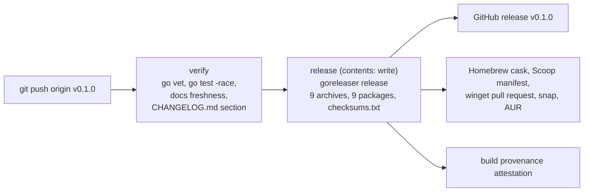

# CI and Release

What each GitHub Actions workflow in `.github/workflows/` does, step by step: when it triggers, which jobs and steps it runs, which requirements it enforces, how to reproduce it locally with the Makefile, and what its common failures mean. Five workflows guard every change (Test, Build, Lint, Docs, Web), a sixth (Action) exercises the setup-gnux GitHub Action, and a seventh (Release) turns a pushed `v*` tag, through GoReleaser, into a GitHub release carrying a statically linked archive per platform, `.deb`, `.rpm` and `.apk` packages, a `checksums.txt` and a provenance attestation, and publishes to Homebrew, Scoop, winget, the Snap Store and the AUR. Setting those up and cutting a release is its own page, [publishing-a-release](publishing-a-release.md). The page ends with where the version string a binary reports comes from, which differs between `make`, `go build`, `go install ...@vX` and a release.

## Overview

| Workflow   | File          | Triggers                                                         | Enforces                                            | Reproduce locally                     |
|------------|---------------|------------------------------------------------------------------|-----------------------------------------------------|---------------------------------------|
| Test       | `test.yml`    | push and PR to `main`                                            | NFR-1, NFR-3, NFR-4, NFR-15, NFR-31, NFR-48, FR-19, FR-29, FR-37 | `make vet test`, `make links`, the wasm build, `go test -fuzz` |
| Build      | `build.yml`   | push and PR to `main`                                            | NFR-1, NFR-2, NFR-4, FR-17, FR-36                   | `CGO_ENABLED=0 make build/all`        |
| Lint       | `lint.yml`    | push and PR to `main` and `staging`                              | NFR-28, NFR-42                                      | `make lint`                           |
| Docs       | `docs.yml`    | push and PR to `main` touching Go, `docs/`, `web/content/docs/`, `tools/` or `go.mod` | FR-41, FR-46, FR-82, NFR-29 | `make docs/check`              |
| Web        | `web.yml`     | push and PR to `main` touching `web/`, Go, `go.mod` or the workflow | NFR-3, NFR-11, NFR-19, NFR-33, FR-47, FR-84, FR-85 | `make web/test`, then `pnpm` steps |
| Bench      | `bench.yml`   | PR to `main` touching Go, `go.mod`, the `Makefile` or the workflow | NFR-52 | `make bench COUNT=5 && make bench/save` on the base, then `make bench COUNT=5 && make bench/check` |
| Action     | `action.yml`  | push and PR to `main` touching `action.yml` or the workflow      | FR-36                                               | the install script with `RUNNER_*` set |
| Release    | `release.yml` | push of a tag matching `v*`                                      | FR-36, FR-38, FR-95, NFR-1, NFR-2, NFR-37           | `make ci`, then `make release/snapshot` |

`make ci` runs `vet`, `lint`, `test` and `docs/check`: the Go half of the gates, on the host
platform only.

### Rules every workflow follows

- **The Go toolchain comes from `go.mod`.** Every `actions/setup-go@v5` step uses
  `go-version-file: go.mod` with `cache: true`, so bumping the `go` line in `go.mod` upgrades CI
  everywhere at once (NFR-41). Never hard-code a version in a workflow.
- **Read-only by default.** Every workflow declares `permissions: contents: read`; only Release's
  `release` job raises it to `contents: write`, plus `id-token: write` and `attestations: write`
  for the provenance attestation (NFR-37).
- **A header comment states the requirement enforced.** When a requirement changes, the
  workflow, the README's Requirements section and the guide (`cmd/docs/guide.go`) change
  together.
- **Dependencies are proposed by Dependabot** (`.github/dependabot.yml`): Go modules weekly,
  GitHub Actions daily, the website's pnpm packages weekly as one grouped update (NFR-20).

## Test (`test.yml`)

**Job `test`**, matrix `os: [ubuntu-latest, macos-latest, windows-latest]`, `fail-fast: false`
so one platform's failure does not hide another's. `defaults.run.shell: bash` on every OS
(git-bash on Windows), so the same command lines parse identically and PowerShell does not
reinterpret the coverage arguments.

| Step                               | Command                                                                  | Why                                          |
|------------------------------------|--------------------------------------------------------------------------|----------------------------------------------|
| Download dependencies              | `go mod download`                                                        | fail fast on a module problem                |
| Vet                                | `go vet ./...`                                                           |                                              |
| Test (race + coverage)             | `go test -race -covermode=atomic -coverprofile=coverage.out ./...`       | the race detector is always on (NFR-15, NFR-31) |
| Smoke test (multi-call dispatch)   | build `bin/gnux[.exe]`, copy it to `bin/pwdx[.exe]`, run `gnux --list`, `gnux pwdx`, `./bin/pwdx` | proves `argv[0]` dispatch with a real binary on every OS; a copy, not a symlink, so it works on Windows (FR-19, FR-37) |
| Build for WebAssembly (ubuntu only) | `GOOS=js GOARCH=wasm go build -o /dev/null ./tools/wasm`                 | every tool must keep compiling for the playground (NFR-3, NFR-4) |
| Fuzz the parsers (ubuntu only)     | `make fuzz FUZZTIME=30s`: the shell's `FuzzParse` and `FuzzExpand`, then `FuzzScript` (sed), `FuzzPattern` (grep), `FuzzExpression` (find), `FuzzInput` (xargs) | no text gnux did not write panics a parser (NFR-48) |
| Upload coverage (ubuntu only)      | artifact `coverage`                                                      |                                              |

Running the suite on three operating systems is what verifies that platform code is isolated
behind build tags with working fallbacks (NFR-4) and that the shell behaves the same everywhere
(FR-29).

**Locally:**

```bash
make vet
make test                                   # go test -race ./...
make cover                                  # the CI flags, plus a coverage summary
make links && ./bin/pwdx                    # the smoke test, via symlinks
GOOS=js GOARCH=wasm go build -o /dev/null ./tools/wasm
```

**Common failures:**

| Symptom                                                        | Likely cause                                                           | Fix                                                        |
|----------------------------------------------------------------|------------------------------------------------------------------------|------------------------------------------------------------|
| Passes on macOS, fails on `windows-latest`                     | A path separator, an error text, or a permission assumption           | Use `filepath`, compare via `core.ErrText`, skip what Windows cannot do (`t.Skipf`) |
| `WARNING: DATA RACE`                                           | Shared state touched by goroutines (a `Diag` bypassed, a map)          | Guard it, or keep the work sequential                      |
| "Build for WebAssembly" fails with an undefined symbol         | A file tagged `unix` with no `!unix` counterpart                       | Add the fallback; `js` is neither `unix` nor `windows`     |
| Smoke test fails on one OS only                                | `progName` normalization, or a tool missing from `--list`              | See [command-line-to-tool-run](command-line-to-tool-run.md) |

## Build (`build.yml`)

**Job `build`**, matrix of nine targets on `ubuntu-latest`: `linux/amd64`, `linux/arm64`,
`linux/riscv64`, `darwin/amd64`, `darwin/arm64`, `freebsd/amd64`, `freebsd/arm64`,
`windows/amd64`, `windows/arm64`, `fail-fast: false`.

```bash
version="$(git describe --tags --always --dirty 2>/dev/null || echo dev)"
go build -trimpath \
  -ldflags "-s -w -X github.com/braswelljr/gnux/internal/common.Version=${version}" \
  -o "dist/gnux-${GOOS}-${GOARCH}/${bin}" .
```

with `CGO_ENABLED=0` set in the step's environment, then each binary is uploaded as artifact
`gnux-<os>-<arch>` (`if-no-files-found: error`).

- `CGO_ENABLED=0` makes every binary statically linked with no libc dependency (NFR-2).
- `-trimpath` removes local paths from the binary; `-s -w` strips symbols and DWARF.
- One build of `.` per platform is the single multi-call binary (FR-17); there is no per-tool
  build.

**Locally:**

```bash
CGO_ENABLED=0 make build/all    # the same nine targets into bin/gnux-<os>-<arch>[.exe]
```

`make build/all` exports `CGO_ENABLED=0` for every target, as CI does. Cross-compiling would
disable cgo anyway, but the host's own target would not, and it must be static too (NFR-2).

**Common failures:** a dependency that needs cgo (any package with `import "C"`), which cannot
build with `CGO_ENABLED=0`, or a build-tagged file with no counterpart for one `GOOS`. Both show
up as a compile error on the affected matrix leg only.

## Lint (`lint.yml`)

**Job `lint`** on `ubuntu-latest`, triggered for `main` and `staging`, with
`concurrency: cancel-in-progress` so a newer push supersedes an older run.
`golangci/golangci-lint-action@v8` runs golangci-lint **pinned to `v2.12.2`** with
`--timeout=5m`. The pin is deliberate: a newer `latest` can tighten the v2 config schema and fail
`config verify` with no change in this repository.

The configuration is `.golangci.yml` (v2 schema): the default linters plus `misspell`
(`locale: US`, NFR-42), `unconvert`, `revive` and `gocritic`; complexity linters disabled;
`_test.go` exempt from `gocritic` and `revive`.

**Locally:** `make lint` uses `golangci-lint` from `PATH`, or `bin/golangci-lint`. Install the
same v2 release CI pins, or results may differ. Formatting is configured there too, under
`formatters` (`gofmt` with `simplify`, and `goimports` with this module as the local prefix), so
`golangci-lint run`, and with it the Lint workflow, reports unformatted code, and `make format`
applies it (`golangci-lint fmt`, then Prettier over the website; `make fix` is the same).

**Git hooks:** `lefthook.yml`, installed with `make hooks`, runs the same checks before they
reach CI. On commit, the staged Go files are formatted with `golangci-lint fmt` and every
package they belong to is linted (a package the machine cannot build is skipped, as `./...`
skips it in CI, and `tools/wasm` is linted as the `js/wasm` build it is); the staged website files are formatted with Prettier and
linted with ESLint (`--max-warnings=0`). Fixes are staged with the commit. On push, `make
docs/check` regenerates `documentation/` and `web/content/docs/` and stops the push when they
differ from what is committed. `LEFTHOOK=0` skips the hooks for one command.

**Common failures:**

| Symptom                                          | Fix                                                                       |
|--------------------------------------------------|---------------------------------------------------------------------------|
| `misspell`: "behaviour" is a misspelling of "behavior" | US spelling in comments and strings                                 |
| `unconvert` flags `uint64(st.Dev)`               | Required on darwin, where `Dev` is `int32`; keep the existing `//nolint:unconvert` |
| `errcheck` on an unchecked error                 | `Close`, `os.Remove` and `fmt.Fprint*` are excluded already; handle anything else |
| `config verify` fails after no config change     | The action ran a different golangci-lint; check the pinned `version`      |

## Docs (`docs.yml`)

**Job `docs`** on `ubuntu-latest`, path-filtered to changes that can affect generated output:
`**.go`, `docs/**`, `web/content/docs/**`, `tools/**`, `go.mod`.

```bash
go generate ./...     # runs both //go:generate lines in main.go
if [ -n "$(git status --porcelain docs web/content/docs)" ]; then
  echo "::error::Generated docs are out of date. Run 'make docs' and commit the result." >&2
  git status --porcelain docs web/content/docs
  git --no-pager diff -- docs web/content/docs
  exit 1
fi
```

It enforces that the committed reference and website content equal what the code generates
(FR-41, FR-46), which in turn depends on generation being deterministic (NFR-29). The full
mechanism is in [documentation-generation](documentation-generation.md).

**Locally:** `make docs/check` (part of `make ci`).

**Common failures:**

| Symptom                                          | Cause                                                            | Fix                                         |
|--------------------------------------------------|------------------------------------------------------------------|---------------------------------------------|
| "Generated docs are out of date" with `M` lines  | A `Meta()`, a flag, `guide.go` or a hand-written doc changed without `make docs` | `make docs`, commit the result |
| Lines starting with `??`                         | New generated files (a new tool's pages) were not added to git   | `git add` them                              |
| Lines starting with ` D`                         | A generated file was deleted by hand, or a tool or flag was removed | Commit the deletion `make docs` produced |
| Fails locally but the diff is a hand-written file | `make docs/check` sees uncommitted edits under `docs/`          | Commit, then re-run                         |

## Web (`web.yml`)

**Job `web`** on `ubuntu-latest`, path-filtered to `web/**`, `**.go`, `go.mod` and the workflow
itself, with `cancel-in-progress` concurrency. Go from `go.mod`; pnpm from
`web/package.json`'s `packageManager`; Node.js 22 with the pnpm cache keyed on
`web/pnpm-lock.yaml`.

| Step                                         | Command (in `web/` unless noted)       | Enforces                                  |
|----------------------------------------------|----------------------------------------|-------------------------------------------|
| Build gnux for WebAssembly (repo root)       | `make web/wasm`                        | NFR-3; the module is built, never committed |
| Install dependencies                         | `pnpm install --frozen-lockfile`       | a lockfile that matches `package.json`    |
| Lint                                         | `pnpm lint` (`eslint .`)               | NFR-28 for the website                    |
| Check formatting                             | `pnpm format:check` (Prettier)         | NFR-28                                    |
| Type-check                                   | `pnpm typecheck` (`next typegen && tsc --noEmit`) |                                |
| Test the playground filesystem against the wasm | `pnpm test` (`node --test "test/**/*.test.ts"`) | FR-47, FR-84, FR-85, NFR-11, NFR-19, NFR-33 |
| Build                                        | `pnpm build`                           | FR-45, FR-49, FR-50, FR-86, NFR-34, NFR-35 (that they build) |
| Check SEO output                             | `pnpm test:seo` (`scripts/check-seo.mjs`) | robots.txt, sitemap, llms.txt, page metadata |

Building the wasm first is what makes `pnpm test` meaningful: `web/test/harness.ts` loads
`public/gnux.wasm` and `public/wasm_exec.js`, so the tests exercise the code in this commit. See
[wasm-playground](wasm-playground.md).

**Locally:**

```bash
make web/wasm
make web/install
make web/test                     # rebuilds the wasm, then pnpm test
cd web && pnpm lint && pnpm format:check && pnpm typecheck && pnpm build && pnpm test:seo
```

**Common failures:**

| Symptom                                                    | Cause                                                        | Fix                                                |
|------------------------------------------------------------|--------------------------------------------------------------|----------------------------------------------------|
| `pnpm install --frozen-lockfile` fails                     | `package.json` changed without updating `pnpm-lock.yaml`     | `pnpm install`, commit the lockfile                |
| `pnpm test` cannot find `public/gnux.wasm`                 | Running the tests without building the module                | `make web/test`, not bare `pnpm test`              |
| "no em dashes in anything we write" in `rules.test.ts`     | A U+2014 character in a web source or markdown file          | Use a colon, comma or " - " instead                |
| A wasm test fails but `go test` passes                     | A difference between the OS and `MemFS` semantics, or a `!unix` fallback | Reproduce with `make web/test`; check `memfs.ts` and `core/fs_other.go` |
| `pnpm build` fails on an MDX page                          | Stale `web/content/docs`, or an unbalanced code fence in a hand-written doc | `make web/docs` (or `make docs`)    |

## Action (`action.yml`)

The repository root's `action.yml` is a composite GitHub Action, setup-gnux, used as
`uses: braswelljr/gnux@v0`. Its one bash step:

1. Maps `RUNNER_OS` / `RUNNER_ARCH` to `<os>-<arch>` (`linux`, `darwin`, `windows`; `amd64`,
   `arm64`), and resolves `version: latest` from the redirect of `/releases/latest`, which
   needs no API token.
2. Downloads `gnux-<tag>-<os>-<arch>.tar.gz` (`.zip` on Windows) and `checksums.txt` into
   `$RUNNER_TEMP`, and checks the archive's line with `sha256sum -c` (`shasum -a 256` on macOS).
3. Unpacks it and, with `links: true` (the default), links every name `gnux --list` prints to
   the binary; on Windows each is a copy (`rmx.exe`), which needs no Developer Mode.
   `gnu-names: true` adds the GNU names (`rm`, `cp`) too.
4. Appends the directory to `$GITHUB_PATH` (converted with `cygpath -w` on Windows) and sets the
   `version` and `path` outputs.

**Workflow `action.yml`** runs the action from the checkout (`uses: ./`) on `ubuntu-latest`,
`ubuntu-24.04-arm`, `macos-latest` and `windows-latest`, for `latest` and a pinned tag, then
uses the tools from bash and, on Windows, PowerShell.

**Locally:** the step is plain bash. Extract it and run it with the runner's variables set:

```bash
RUNNER_OS=macOS RUNNER_ARCH=ARM64 RUNNER_TEMP=/tmp/rt GITHUB_PATH=/tmp/rt/path \
GITHUB_OUTPUT=/tmp/rt/out VERSION=latest LINKS=true GNU_NAMES=false bash setup.sh
```

## Release (`release.yml`)

A release is: **push a `v*` tag, the Release workflow verifies the tagged commit, then
GoReleaser builds one archive per platform, publishes a GitHub release with every archive, a
`checksums.txt` and a provenance attestation, and updates the package manager manifests.**
What is built and published is described once, in `.goreleaser.yaml`.



### Trigger

```yaml
on:
  push:
    tags: ["v[0-9]+.[0-9]+.[0-9]+*"]
```

Only full versions (`v0.1.0`, `v1.0.0-rc.1`) release. The major tags (`v0`, `v1`) that
`uses: braswelljr/gnux@v0` resolves are not releases: the last step of `release` moves the
major tag to each stable release (a prerelease leaves it alone). Workflow-level permissions are
`contents: read`; only `release` writes (NFR-37).

### Job `verify`

On `ubuntu-latest`, against the tagged commit: `go vet ./...`, `go test -race ./...`, and the
docs freshness check (`go generate ./...` then `git status --porcelain docs web/content/docs`).
The point is that a tag cannot publish what CI would reject, even if it was pushed on a commit
that never went through a pull request.

Last, `go run ./tools/changelog "$TAG"` prints the tag's section of `CHANGELOG.md` (the lines
under `## [0.1.0]`, for `v0.1.0`) into `release-notes.md`, uploaded as the `release-notes`
artifact. A release tag with no section, or an empty one, fails here, before anything is built;
a prerelease tag (one with a hyphen) without one gets an empty file and generated notes. It does not repeat Lint, the Windows and macOS test
legs, or Web; those are expected to be green on `main` before tagging.

### Job `release`

`needs: verify`, with `contents: write`, `id-token: write` and `attestations: write`:

1. Check out with full history (GoReleaser reads the previous tag for generated notes), set up
   Go from `go.mod`, and download the `release-notes` artifact.
2. **Choose what to publish.** Each package manager is pushed to a repository or store of its
   own with a credential stored as a secret: `HOMEBREW_TAP_GITHUB_TOKEN`
   (`braswelljr/homebrew-tap`), `SCOOP_BUCKET_GITHUB_TOKEN` (`braswelljr/scoop-bucket`),
   `WINGET_GITHUB_TOKEN` (a fork, `braswelljr/winget-pkgs`, from which a pull request to
   `microsoft/winget-pkgs` is opened), `SNAPCRAFT_STORE_CREDENTIALS` (the Snap Store) and
   `AUR_KEY` (`gnux-bin` on the AUR). A missing secret adds that publisher to `--skip`, so a
   fork can still release; with the snap's secret set, the next step installs `snapcraft`. The
   notes file is passed as `--release-notes` when it is not empty.
   [publishing-a-release](publishing-a-release.md) says how to create each secret.
3. **Build and publish** with `goreleaser/goreleaser-action@v6` (GoReleaser v2):
   - the `before` hook writes `completions/gnux.{bash,zsh,fish,ps1}` with `go run . completion`;
   - builds `unix` (linux amd64/arm64/riscv64, darwin and freebsd amd64/arm64) and `windows`
     (amd64/arm64), each `CGO_ENABLED=0`, `-trimpath`, `-s -w` and `Version={{ .Tag }}`;
   - archives `gnux-<tag>-<os>-<arch>`, wrapped in a directory of the same name, with
     `LICENSE`, `README.md` and the completions, plus `man/` from `documentation/man` on Unix;
     `.tar.gz` on Unix and `.zip` on Windows, the naming every earlier release used;
   - `gnux-<tag>-linux-<arch>.deb`, `.rpm` and `.apk` for the three Linux architectures, each
     installing `/usr/bin/gnux` and the completions;
   - `checksums.txt` (SHA-256), covering the archives and the packages;
   - the release, titled `gnux <tag>`, a prerelease when the tag has a hyphen, and with
     `mode: replace` so a release already drafted in GitHub's web interface is completed;
   - the Homebrew cask (installs the completions and clears the quarantine flag), the Scoop
     manifest, the winget manifests, a strictly confined snap per Linux architecture and the
     AUR's `gnux-bin`. A prerelease reaches none of them but the snap's `edge` channel
     (`skip_upload: auto`).
4. **Attest build provenance** with `actions/attest-build-provenance@v2` over every file in
   `checksums.txt`; `gh attestation verify <archive> --repo braswelljr/gnux` checks one.
5. **Move the major version tag** (`v0` for `v0.1.0`) to the release, unless it is a prerelease,
   so the setup-gnux action's `@v0` follows the newest stable release.

The result, for `v0.1.0`:

```text
gnux-v0.1.0-darwin-amd64.tar.gz
gnux-v0.1.0-darwin-arm64.tar.gz
gnux-v0.1.0-freebsd-amd64.tar.gz
gnux-v0.1.0-freebsd-arm64.tar.gz
gnux-v0.1.0-linux-amd64.tar.gz
gnux-v0.1.0-linux-arm64.tar.gz
gnux-v0.1.0-linux-riscv64.tar.gz
gnux-v0.1.0-windows-amd64.zip
gnux-v0.1.0-windows-arm64.zip
gnux-v0.1.0-linux-{amd64,arm64,riscv64}.{deb,rpm,apk}
checksums.txt
```

### Cutting a release

`CHANGELOG.md` is kept as changes are made, under `## [Unreleased]`. In short (the full
procedure, with the checks before and after, is [publishing-a-release](publishing-a-release.md)):

1. Rename that heading to the version and date, `## [0.1.0] - 2026-10-20`, and start a new,
   empty `## [Unreleased]` above it.
2. Update the link definitions at the bottom: `[Unreleased]` compares the new tag with `HEAD`,
   and the version's link compares it with the previous tag (or, for the first, points at it).
3. Check the notes the release will carry, then commit (the pre-push hook regenerates
   `/docs/changelog` and stops the push if it is stale), tag and push:

```bash
go run ./tools/changelog v0.1.0             # the release notes, or why there are none
make ci                                     # the Go gates, locally
git commit -am "release: v0.1.0"
git tag -a v0.1.0 -m "gnux v0.1.0"
git push origin main v0.1.0
```

### Reproducing a release locally

`make release/check` validates `.goreleaser.yaml`, and `make release/snapshot` runs the whole
build without publishing (`goreleaser release --snapshot --clean --skip=publish`): every
archive and package, `checksums.txt`, and the generated cask, Scoop manifest, winget manifests
and `PKGBUILD`, in `dist/`. Both need [GoReleaser](https://goreleaser.com/install/) v2 on
`PATH`; the snaps are built only where `snapcraft` is installed.

```text
$ make release/snapshot
$ ls dist/*.tar.gz dist/*.zip | wc -l
9
$ tar -tzf dist/gnux-v0.1.0-darwin-arm64.tar.gz | head -6
gnux-v0.1.0-darwin-arm64/LICENSE
gnux-v0.1.0-darwin-arm64/README.md
gnux-v0.1.0-darwin-arm64/completions/gnux.bash
gnux-v0.1.0-darwin-arm64/completions/gnux.fish
gnux-v0.1.0-darwin-arm64/completions/gnux.zsh
gnux-v0.1.0-darwin-arm64/man/basenamex/index.1
$ cat dist/homebrew/Casks/gnux.rb dist/scoop/gnux.json    # the manifests that would be pushed
```

Users verify a download with the checksums, or with the attestation:

```bash
sha256sum --check --ignore-missing checksums.txt
gh attestation verify gnux-v0.1.0-linux-amd64.tar.gz --repo braswelljr/gnux
```

### Common failures

| Symptom                                       | Cause                                                        | Fix                                                        |
|-----------------------------------------------|--------------------------------------------------------------|------------------------------------------------------------|
| `verify` fails                                | The tagged commit fails a test or has stale docs             | Fix on `main`, delete the tag (`git push --delete origin v0.1.0`), tag again |
| GoReleaser fails to build one target and nothing is published | A platform-specific compile error                | Fix it (`make build/all` reproduces it); re-tag            |
| GoReleaser: "git is in a dirty state"          | A step wrote into the checkout before GoReleaser ran       | Write into `dist/` or a gitignored path (`completions/` is ignored) |
| A package manager is not updated               | Its token secret is not set, so it was skipped              | Add the secret; the next release publishes it              |
| Homebrew/Scoop push fails with 403/404         | The tap or bucket repository is missing, or the token cannot write to it | Create the repository; give the token `contents: write` on it |
| Man pages in the archive carry "Jan 2024"     | `docs.ManDate` is pinned for reproducibility, and nothing sets it per release | Known gap                                 |

## Where the version comes from

`internal/common/common.go` holds `var Version = "dev"` and an `init` that falls back to the
module's build info:

```go
func init() {
	if Version != "dev" {
		return
	}
	Version = buildInfoVersion(debug.ReadBuildInfo())
}

func buildInfoVersion(info *debug.BuildInfo, ok bool) string {
	if !ok || info == nil {
		return "dev"
	}
	if v := info.Main.Version; v != "" && v != "(devel)" {
		return v
	}
	return "dev"
}
```

`PrintVersion` prints it as `gnux VERSION` or `TOOL (gnux) VERSION` (FR-38). Which value a
binary reports depends on how it was built:

| Built with                                          | `Version`                                   | Example                                            |
|-----------------------------------------------------|---------------------------------------------|----------------------------------------------------|
| The Release workflow                                | the tag, via `-ldflags -X`                  | `gnux v0.1.0`                                      |
| `make build`, `make install`, the Build workflow    | `git describe --tags --always --dirty`, via `-ldflags -X` | a tag, or a commit hash with no tags       |
| `go install github.com/braswelljr/gnux@v0.1.0`      | the module version from build info          | `gnux v0.1.0`                                      |
| `go build .` in a checkout                          | the VCS-derived pseudo-version from build info | `gnux v0.0.0-20260702171831-1d15ddee257f+dirty` |
| `go run .`, `go test`                               | `dev` (build info reports `(devel)` or none) | `gnux dev`                                        |

The `-X` link flag always wins, because `init` returns early when `Version` is no longer `dev`.
The fallback is what lets `go install ...@vX` report the tag without any link flags.
`TestBuildInfoVersion` in `internal/common/common_test.go` covers each row of the fallback.

## Related

- User-facing release flow: WF-9 in [srs-workflows](../requirements/srs-workflows.md).
- [documentation-generation](documentation-generation.md) for what the Docs check compares.
- [wasm-playground](wasm-playground.md) for what the Web workflow tests.
- [non-functional-requirements](../requirements/non-functional-requirements.md) for each
  NFR's measure and verification.
- The [rules](../rules/README.md) and [guides](../../documentation/guides/README.md).
