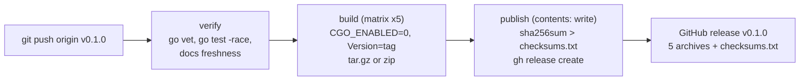

# CI and Release

What each GitHub Actions workflow in `.github/workflows/` does, step by step: when it triggers, which jobs and steps it runs, which requirements it enforces, how to reproduce it locally with the Makefile, and what its common failures mean. Five workflows guard every change (Test, Build, Lint, Docs, Web) and a sixth (Release) turns a pushed `v*` tag into a GitHub release carrying a statically linked archive per platform and a `checksums.txt`. The page ends with where the version string a binary reports comes from, which differs between `make`, `go build`, `go install ...@vX` and a release.

## Overview

| Workflow   | File          | Triggers                                                         | Enforces                                            | Reproduce locally                     |
|------------|---------------|------------------------------------------------------------------|-----------------------------------------------------|---------------------------------------|
| Test       | `test.yml`    | push and PR to `main`                                            | NFR-1, NFR-3, NFR-4, NFR-15, NFR-31, FR-19, FR-29, FR-37 | `make vet test`, `make links`, the wasm build |
| Build      | `build.yml`   | push and PR to `main`                                            | NFR-1, NFR-2, NFR-4, FR-17, FR-36                   | `CGO_ENABLED=0 make build/all`        |
| Lint       | `lint.yml`    | push and PR to `main` and `staging`                              | NFR-28, NFR-42                                      | `make lint`                           |
| Docs       | `docs.yml`    | push and PR to `main` touching Go, `docs/`, `web/content/docs/`, `tools/` or `go.mod` | FR-41, FR-46, FR-82, NFR-29 | `make docs/check`              |
| Web        | `web.yml`     | push and PR to `main` touching `web/`, Go, `go.mod` or the workflow | NFR-3, NFR-11, NFR-19, NFR-33, FR-47, FR-84, FR-85 | `make web/test`, then `pnpm` steps |
| Release    | `release.yml` | push of a tag matching `v*`                                      | FR-36, FR-38, NFR-1, NFR-2, NFR-37                  | `make ci`, then a manual archive build |

`make ci` runs `vet`, `lint`, `test` and `docs/check`: the Go half of the gates, on the host
platform only.

### Rules every workflow follows

- **The Go toolchain comes from `go.mod`.** Every `actions/setup-go@v5` step uses
  `go-version-file: go.mod` with `cache: true`, so bumping the `go` line in `go.mod` upgrades CI
  everywhere at once (NFR-41). Never hard-code a version in a workflow.
- **Read-only by default.** Every workflow declares `permissions: contents: read`; only Release's
  `publish` job raises it to `contents: write` (NFR-37).
- **A header comment states the requirement enforced.** When a requirement changes, the
  workflow, the README's Requirements section and the guide (`cmd/docs/guide.go`) change
  together.
- **Dependencies are proposed by Dependabot** (`.github/dependabot.yml`): Go modules weekly,
  GitHub Actions daily (NFR-20).

## Test (`test.yml`)

**Job `test`**, matrix `os: [ubuntu-latest, macos-latest, windows-latest]`, `fail-fast: false`
so one platform's failure does not hide another's. `defaults.run.shell: bash` on every OS
(git-bash on Windows), so the same command lines parse identically and PowerShell does not
reinterpret the coverage arguments.

| Step                               | Command                                                                  | Why                                          |
|------------------------------------|--------------------------------------------------------------------------|----------------------------------------------|
| Download dependencies              | `go mod download`                                                        | fail fast on a module problem                |
| Vet                                | `go vet ./...`                                                           |                                              |
| Test (race + coverage)             | `go test -race -covermode=atomic -coverprofile=coverage.out ./...`       | the race detector is always on (NFR-15, NFR-31) |
| Smoke test (multi-call dispatch)   | build `bin/gnux[.exe]`, copy it to `bin/pwdx[.exe]`, run `gnux --list`, `gnux pwdx`, `./bin/pwdx` | proves `argv[0]` dispatch with a real binary on every OS; a copy, not a symlink, so it works on Windows (FR-19, FR-37) |
| Build for WebAssembly (ubuntu only) | `GOOS=js GOARCH=wasm go build -o /dev/null ./tools/wasm`                 | every tool must keep compiling for the playground (NFR-3, NFR-4) |
| Upload coverage (ubuntu only)      | artifact `coverage`                                                      |                                              |

Running the suite on three operating systems is what verifies that platform code is isolated
behind build tags with working fallbacks (NFR-4) and that the shell behaves the same everywhere
(FR-29).

**Locally:**

```bash
make vet
make test                                   # go test -race ./...
make cover                                  # the CI flags, plus a coverage summary
make links && ./bin/pwdx                    # the smoke test, via symlinks
GOOS=js GOARCH=wasm go build -o /dev/null ./tools/wasm
```

**Common failures:**

| Symptom                                                        | Likely cause                                                           | Fix                                                        |
|----------------------------------------------------------------|------------------------------------------------------------------------|------------------------------------------------------------|
| Passes on macOS, fails on `windows-latest`                     | A path separator, an error text, or a permission assumption           | Use `filepath`, compare via `core.ErrText`, skip what Windows cannot do (`t.Skipf`) |
| `WARNING: DATA RACE`                                           | Shared state touched by goroutines (a `Diag` bypassed, a map)          | Guard it, or keep the work sequential                      |
| "Build for WebAssembly" fails with an undefined symbol         | A file tagged `unix` with no `!unix` counterpart                       | Add the fallback; `js` is neither `unix` nor `windows`     |
| Smoke test fails on one OS only                                | `progName` normalization, or a tool missing from `--list`              | See [command-line-to-tool-run](command-line-to-tool-run.md) |

## Build (`build.yml`)

**Job `build`**, matrix of five targets on `ubuntu-latest`: `linux/amd64`, `linux/arm64`,
`darwin/amd64`, `darwin/arm64`, `windows/amd64`, `fail-fast: false`.

```bash
version="$(git describe --tags --always --dirty 2>/dev/null || echo dev)"
go build -trimpath \
  -ldflags "-s -w -X github.com/braswelljr/gnux/internal/common.Version=${version}" \
  -o "dist/gnux-${GOOS}-${GOARCH}/${bin}" .
```

with `CGO_ENABLED=0` set in the step's environment, then each binary is uploaded as artifact
`gnux-<os>-<arch>` (`if-no-files-found: error`).

- `CGO_ENABLED=0` makes every binary statically linked with no libc dependency (NFR-2).
- `-trimpath` removes local paths from the binary; `-s -w` strips symbols and DWARF.
- One build of `.` per platform is the single multi-call binary (FR-17); there is no per-tool
  build.

**Locally:**

```bash
CGO_ENABLED=0 make build/all    # the same five targets into bin/gnux-<os>-<arch>[.exe]
```

`make build/all` exports `CGO_ENABLED=0` for every target, as CI does. Cross-compiling would
disable cgo anyway, but the host's own target would not, and it must be static too (NFR-2).

**Common failures:** a dependency that needs cgo (any package with `import "C"`), which cannot
build with `CGO_ENABLED=0`, or a build-tagged file with no counterpart for one `GOOS`. Both show
up as a compile error on the affected matrix leg only.

## Lint (`lint.yml`)

**Job `lint`** on `ubuntu-latest`, triggered for `main` and `staging`, with
`concurrency: cancel-in-progress` so a newer push supersedes an older run.
`golangci/golangci-lint-action@v8` runs golangci-lint **pinned to `v2.12.2`** with
`--timeout=5m`. The pin is deliberate: a newer `latest` can tighten the v2 config schema and fail
`config verify` with no change in this repository.

The configuration is `.golangci.yml` (v2 schema): the default linters plus `misspell`
(`locale: US`, NFR-42), `unconvert`, `revive` and `gocritic`; complexity linters disabled;
`_test.go` exempt from `gocritic` and `revive`.

**Locally:** `make lint` uses `golangci-lint` from `PATH`, or `bin/golangci-lint`. Install the
same v2 release CI pins, or results may differ. Formatting is configured there too, under
`formatters` (`gofmt` with `simplify`, and `goimports` with this module as the local prefix), so
`golangci-lint run`, and with it the Lint workflow, reports unformatted code, and `make format`
applies it (`golangci-lint fmt`, then Prettier over the website; `make fix` is the same).

**Git hooks:** `lefthook.yml`, installed with `make hooks`, runs the same checks before they
reach CI. On commit, the staged Go files are formatted with `golangci-lint fmt` and every
package they belong to is linted (a package the machine cannot build is skipped, as `./...`
skips it in CI, and `tools/wasm` is linted as the `js/wasm` build it is); the staged website files are formatted with Prettier and
linted with ESLint (`--max-warnings=0`). Fixes are staged with the commit. On push, `make
docs/check` regenerates `documentation/` and `web/content/docs/` and stops the push when they
differ from what is committed. `LEFTHOOK=0` skips the hooks for one command.

**Common failures:**

| Symptom                                          | Fix                                                                       |
|--------------------------------------------------|---------------------------------------------------------------------------|
| `misspell`: "behaviour" is a misspelling of "behavior" | US spelling in comments and strings                                 |
| `unconvert` flags `uint64(st.Dev)`               | Required on darwin, where `Dev` is `int32`; keep the existing `//nolint:unconvert` |
| `errcheck` on an unchecked error                 | `Close`, `os.Remove` and `fmt.Fprint*` are excluded already; handle anything else |
| `config verify` fails after no config change     | The action ran a different golangci-lint; check the pinned `version`      |

## Docs (`docs.yml`)

**Job `docs`** on `ubuntu-latest`, path-filtered to changes that can affect generated output:
`**.go`, `docs/**`, `web/content/docs/**`, `tools/**`, `go.mod`.

```bash
go generate ./...     # runs both //go:generate lines in main.go
if [ -n "$(git status --porcelain docs web/content/docs)" ]; then
  echo "::error::Generated docs are out of date. Run 'make docs' and commit the result." >&2
  git status --porcelain docs web/content/docs
  git --no-pager diff -- docs web/content/docs
  exit 1
fi
```

It enforces that the committed reference and website content equal what the code generates
(FR-41, FR-46), which in turn depends on generation being deterministic (NFR-29). The full
mechanism is in [documentation-generation](documentation-generation.md).

**Locally:** `make docs/check` (part of `make ci`).

**Common failures:**

| Symptom                                          | Cause                                                            | Fix                                         |
|--------------------------------------------------|------------------------------------------------------------------|---------------------------------------------|
| "Generated docs are out of date" with `M` lines  | A `Meta()`, a flag, `guide.go` or a hand-written doc changed without `make docs` | `make docs`, commit the result |
| Lines starting with `??`                         | New generated files (a new tool's pages) were not added to git   | `git add` them                              |
| Lines starting with ` D`                         | A generated file was deleted by hand, or a tool or flag was removed | Commit the deletion `make docs` produced |
| Fails locally but the diff is a hand-written file | `make docs/check` sees uncommitted edits under `docs/`          | Commit, then re-run                         |

## Web (`web.yml`)

**Job `web`** on `ubuntu-latest`, path-filtered to `web/**`, `**.go`, `go.mod` and the workflow
itself, with `cancel-in-progress` concurrency. Go from `go.mod`; pnpm from
`web/package.json`'s `packageManager`; Node.js 22 with the pnpm cache keyed on
`web/pnpm-lock.yaml`.

| Step                                         | Command (in `web/` unless noted)       | Enforces                                  |
|----------------------------------------------|----------------------------------------|-------------------------------------------|
| Build gnux for WebAssembly (repo root)       | `make web/wasm`                        | NFR-3; the module is built, never committed |
| Install dependencies                         | `pnpm install --frozen-lockfile`       | a lockfile that matches `package.json`    |
| Lint                                         | `pnpm lint` (`eslint .`)               | NFR-28 for the website                    |
| Check formatting                             | `pnpm format:check` (Prettier)         | NFR-28                                    |
| Type-check                                   | `pnpm typecheck` (`next typegen && tsc --noEmit`) |                                |
| Test the playground filesystem against the wasm | `pnpm test` (`node --test "test/**/*.test.ts"`) | FR-47, FR-84, FR-85, NFR-11, NFR-19, NFR-33 |
| Build                                        | `pnpm build`                           | FR-45, FR-49, FR-50, FR-86, NFR-34, NFR-35 (that they build) |
| Check SEO output                             | `pnpm test:seo` (`scripts/check-seo.mjs`) | robots.txt, sitemap, llms.txt, page metadata |

Building the wasm first is what makes `pnpm test` meaningful: `web/test/harness.ts` loads
`public/gnux.wasm` and `public/wasm_exec.js`, so the tests exercise the code in this commit. See
[wasm-playground](wasm-playground.md).

**Locally:**

```bash
make web/wasm
make web/install
make web/test                     # rebuilds the wasm, then pnpm test
cd web && pnpm lint && pnpm format:check && pnpm typecheck && pnpm build && pnpm test:seo
```

**Common failures:**

| Symptom                                                    | Cause                                                        | Fix                                                |
|------------------------------------------------------------|--------------------------------------------------------------|----------------------------------------------------|
| `pnpm install --frozen-lockfile` fails                     | `package.json` changed without updating `pnpm-lock.yaml`     | `pnpm install`, commit the lockfile                |
| `pnpm test` cannot find `public/gnux.wasm`                 | Running the tests without building the module                | `make web/test`, not bare `pnpm test`              |
| "no em dashes in anything we write" in `rules.test.ts`     | A U+2014 character in a web source or markdown file          | Use a colon, comma or " - " instead                |
| A wasm test fails but `go test` passes                     | A difference between the OS and `MemFS` semantics, or a `!unix` fallback | Reproduce with `make web/test`; check `memfs.ts` and `core/fs_other.go` |
| `pnpm build` fails on an MDX page                          | Stale `web/content/docs`, or an unbalanced code fence in a hand-written doc | `make web/docs` (or `make docs`)    |

## Release (`release.yml`)

A release is: **push a `v*` tag, the Release workflow verifies the tagged commit, builds one
archive per platform, and publishes a GitHub release with every archive and a
`checksums.txt`.**



### Trigger

```yaml
on:
  push:
    tags: ["v*"]
```

Workflow-level permissions are `contents: read`; only `publish` writes (NFR-37).

### Job `verify`

On `ubuntu-latest`, against the tagged commit: `go vet ./...`, `go test -race ./...`, and the
docs freshness check (`go generate ./...` then `git status --porcelain docs web/content/docs`).
The point is that a tag cannot publish what CI would reject, even if it was pushed on a commit
that never went through a pull request. It does not repeat Lint, the Windows and macOS test
legs, or Web; those are expected to be green on `main` before tagging.

### Job `build`

`needs: verify`. The same five-target matrix as Build, but `fail-fast: true`: a release missing
one platform is not published at all. For each target:

```bash
name="gnux-${VERSION}-${GOOS}-${GOARCH}"          # VERSION = github.ref_name, e.g. v0.1.0
go build -trimpath \
  -ldflags "-s -w -X github.com/braswelljr/gnux/internal/common.Version=${VERSION}" \
  -o "dist/${name}/${bin}" .
cp LICENSE README.md "dist/${name}/"
[ "$GOOS" != "windows" ] && cp -r documentation/man "dist/${name}/man"   # man pages on Unix only
# windows: zip -qr "${name}.zip" "${name}"   otherwise: tar -czf "${name}.tar.gz" "${name}"
```

with `CGO_ENABLED=0` (NFR-2). The archives are uploaded as `archive-<os>-<arch>`. Shipping the
man pages relies on the committed `documentation/man/`, which `verify` has just proven current.

### Job `publish`

`needs: build`, `permissions: contents: write`:

1. Download every `archive-*` artifact into `dist/` (`merge-multiple: true`).
2. `sha256sum gnux-* > checksums.txt` in `dist/`.
3. `gh release create "$TAG" dist/* --title "gnux $TAG" --generate-notes`, adding
   `--prerelease` when the tag contains a hyphen (`v1.0.0-rc.1`).

The result, for `v0.1.0`:

```text
gnux-v0.1.0-linux-amd64.tar.gz
gnux-v0.1.0-linux-arm64.tar.gz
gnux-v0.1.0-darwin-amd64.tar.gz
gnux-v0.1.0-darwin-arm64.tar.gz
gnux-v0.1.0-windows-amd64.zip
checksums.txt
```

### Cutting a release

```bash
make ci                                     # the Go gates, locally
git tag -a v0.1.0 -m "gnux v0.1.0"
git push origin v0.1.0
```

### Reproducing one archive locally

The build step is plain shell, so one leg can be run by hand. Done for the host platform in a
scratch directory, with a test version:

```text
$ VERSION=v0.0.0-test; name="gnux-${VERSION}-darwin-arm64"
$ GOOS=darwin GOARCH=arm64 CGO_ENABLED=0 go build -trimpath \
    -ldflags "-s -w -X github.com/braswelljr/gnux/internal/common.Version=${VERSION}" \
    -o "dist/${name}/gnux" .
$ cp LICENSE README.md "dist/${name}/" && cp -r documentation/man "dist/${name}/man"
$ (cd dist && tar -czf "${name}.tar.gz" "${name}" && shasum -a 256 gnux-*.tar.gz > checksums.txt)
$ (cd dist && shasum -a 256 -c checksums.txt)
gnux-v0.0.0-test-darwin-arm64.tar.gz: OK
$ tar -tzf "dist/${name}.tar.gz" | head -6
gnux-v0.0.0-test-darwin-arm64/
gnux-v0.0.0-test-darwin-arm64/man/
gnux-v0.0.0-test-darwin-arm64/LICENSE
gnux-v0.0.0-test-darwin-arm64/README.md
gnux-v0.0.0-test-darwin-arm64/gnux
gnux-v0.0.0-test-darwin-arm64/man/index.1
$ "dist/${name}/gnux" --version
gnux v0.0.0-test
$ "dist/${name}/gnux" rmx --version
rmx (gnux) v0.0.0-test
```

(`shasum -a 256` is the macOS spelling of `sha256sum`.) Users verify a download the same way:

```bash
sha256sum --check --ignore-missing checksums.txt
```

### Common failures

| Symptom                                       | Cause                                                        | Fix                                                        |
|-----------------------------------------------|--------------------------------------------------------------|------------------------------------------------------------|
| `verify` fails                                | The tagged commit fails a test or has stale docs             | Fix on `main`, delete the tag (`git push --delete origin v0.1.0`), tag again |
| One `build` leg fails and nothing is published | `fail-fast: true`, by design                                | Fix the platform problem; re-tag                           |
| `gh release create` fails: release already exists | The tag was released before                              | Delete the release, or tag a new version                   |
| Man pages in the archive carry "Jan 2024"     | `docs.ManDate` is pinned for reproducibility, and nothing sets it per release | Known gap                                 |

## Where the version comes from

`internal/common/common.go` holds `var Version = "dev"` and an `init` that falls back to the
module's build info:

```go
func init() {
	if Version != "dev" {
		return
	}
	Version = buildInfoVersion(debug.ReadBuildInfo())
}

func buildInfoVersion(info *debug.BuildInfo, ok bool) string {
	if !ok || info == nil {
		return "dev"
	}
	if v := info.Main.Version; v != "" && v != "(devel)" {
		return v
	}
	return "dev"
}
```

`PrintVersion` prints it as `gnux VERSION` or `TOOL (gnux) VERSION` (FR-38). Which value a
binary reports depends on how it was built:

| Built with                                          | `Version`                                   | Example                                            |
|-----------------------------------------------------|---------------------------------------------|----------------------------------------------------|
| The Release workflow                                | the tag, via `-ldflags -X`                  | `gnux v0.1.0`                                      |
| `make build`, `make install`, the Build workflow    | `git describe --tags --always --dirty`, via `-ldflags -X` | a tag, or a commit hash with no tags       |
| `go install github.com/braswelljr/gnux@v0.1.0`      | the module version from build info          | `gnux v0.1.0`                                      |
| `go build .` in a checkout                          | the VCS-derived pseudo-version from build info | `gnux v0.0.0-20260702171831-1d15ddee257f+dirty` |
| `go run .`, `go test`                               | `dev` (build info reports `(devel)` or none) | `gnux dev`                                        |

The `-X` link flag always wins, because `init` returns early when `Version` is no longer `dev`.
The fallback is what lets `go install ...@vX` report the tag without any link flags.
`TestBuildInfoVersion` in `internal/common/common_test.go` covers each row of the fallback.

## Related

- User-facing release flow: WF-9 in [srs-workflows](../requirements/srs-workflows.md).
- [documentation-generation](documentation-generation.md) for what the Docs check compares.
- [wasm-playground](wasm-playground.md) for what the Web workflow tests.
- [non-functional-requirements](../requirements/non-functional-requirements.md) for each
  NFR's measure and verification.
- The [rules](../rules/README.md) and [guides](../../documentation/guides/README.md).
