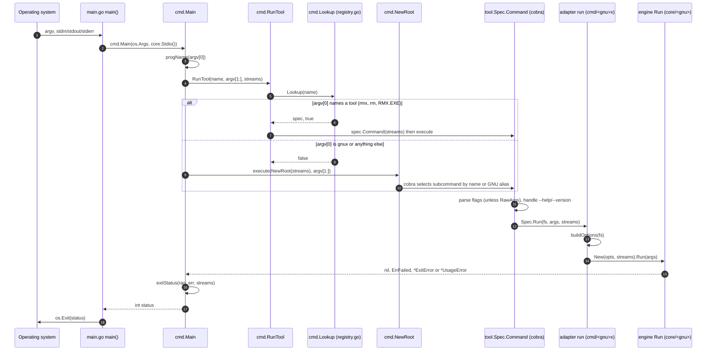

# Command Line to Tool Run

How a command line becomes a tool run inside gnux: `main.go` hands the raw `argv` and the process streams to `cmd.Main`, which reduces `argv[0]` to a bare program name, looks it up in the registry, and either runs that tool's cobra command directly or falls back to the `gnux` root command, where the first argument picks the tool. Every tool command is built from a `tool.Spec` by `Spec.Command`, which adds `--help` and `--version`, honors `RawArgs` and `NoInterspersed`, and records the tool's diagnostic name and usage-error status on the command so that `cmd.Main` can turn whatever the engine returns into a GNU-style message and exit status. Every other workflow (the shell, the playground, the library's `cmd.RunTool`) passes through the same code.

## The path at a glance



## Step 1: `main.go` passes everything through

`main.go` is deliberately one line of logic:

```go
func main() {
	os.Exit(cmd.Main(os.Args, core.Stdio()))
}
```

Nothing is parsed here and nothing is decided. Keeping the decision in `cmd.Main`, which takes
`argv` and a `core.Streams` and returns an `int`, means the whole command line can be driven
from a test or an embedding program without spawning a process or touching `os.Exit`
(FR-80). Every test in `cmd/main_test.go` runs through `Main` with in-memory buffers:

```go
status = Main(argv, core.Streams{In: strings.NewReader(""), Out: &out, Err: &errb})
```

`core.Stdio()` is the only place the process streams are named. Below `main.go`, tools read
and write only the `core.Streams` they are handed (FR-32).

The file also carries the two `//go:generate` lines that rebuild the documentation; see
[documentation-generation](documentation-generation.md).

## Step 2: `argv[0]` is reduced to a program name

`cmd.Main` in `cmd/main.go` first normalizes `argv[0]` with `progName`:

```go
func progName(arg0 string) string {
	if i := strings.LastIndexAny(arg0, `/\`); i >= 0 {
		arg0 = arg0[i+1:]
	}
	arg0 = filepath.Base(arg0)
	if ext := filepath.Ext(arg0); strings.EqualFold(ext, ".exe") {
		arg0 = strings.TrimSuffix(arg0, ext)
	}
	return strings.ToLower(arg0)
}
```

Each step exists for a platform (FR-76):

| Step                              | Why                                                                                  |
|-----------------------------------|--------------------------------------------------------------------------------------|
| Cut at the last `/` or `\`        | A Windows path (`C:\tools\rmx.exe`) must be handled on every OS, not only on Windows, because `filepath` only knows the host separator |
| `filepath.Base`                   | Belt and braces for the host's own separator rules                                   |
| Strip `.exe`, case-insensitively  | Windows starts programs as `rmx.exe`; a copied binary is how Windows users get per-tool commands |
| Lower-case                        | `RMX.EXE` on a case-insensitive filesystem must still select `rmx`                   |

`TestProgName` pins the table: `rmx`, `/usr/local/bin/rmx`, `C:\tools\rmx.exe`, `./bin/gnux`
and `RMX.EXE`.

## Step 3: the registry decides between "tool" and "gnux"

`cmd.Main` then tries the name as a tool:

```go
if status, ok := RunTool(progName(argv[0]), args, s); ok {
	return status
}
return execute(NewRoot(s), args, s)
```

`RunTool` calls `Lookup` in `cmd/registry.go`, which walks `Tools()` and matches either the
command name (`s.Name()`, that is `Meta.Name`, such as `rmx`) or the GNU name (`s.GNU`, such as
`rm`):

```go
for _, s := range Tools() {
	if name == s.Name() || (s.GNU != "" && name == s.GNU) {
		return s, true
	}
}
```

So a binary linked or copied to `rmx` or to `rm` runs `rmx` directly with the remaining
arguments (FR-19, FR-20). Anything else, including `gnux` itself, falls through to the root
command (FR-18).

Two consequences of using `Tools()` rather than `Commands()` here:

- `gnux shell` is in `Commands()` but not in `Tools()`, so a binary named `shell` does not start
  the shell, and `RunTool("shell", ...)` reports `ok == false` (FR-77). The shell is reachable
  only as `gnux shell`.
- `Tools()` builds every `Spec` on each call. That is cheap (each `Spec()` only fills a struct)
  and keeps the registry a plain function with no package-level state.

Real output from a build in a scratch directory, where `rmx`, `rm` and `RMX.EXE` are links or
copies of the same binary:

```text
$ ./gnux --version
gnux v0.0.0-20260702171831-1d15ddee257f+dirty
$ ./rmx --version
rmx (gnux) v0.0.0-20260702171831-1d15ddee257f+dirty
$ ./rm --version
rmx (gnux) v0.0.0-20260702171831-1d15ddee257f+dirty
$ ./RMX.EXE --version
rmx (gnux) v0.0.0-20260702171831-1d15ddee257f+dirty
$ ./gnux rm --version
rmx (gnux) v0.0.0-20260702171831-1d15ddee257f+dirty
```

The version is a pseudo-version because that build had no `-ldflags`; see
[ci-and-release](ci-and-release.md#where-the-version-comes-from).

## Step 4: the root command (only when `argv[0]` is not a tool)

`cmd.NewRoot` in `cmd/root.go` builds the `gnux` command:

- `Args: cobra.ArbitraryArgs`, so an unknown first word reaches `RunE` instead of being
  rejected by cobra with its own wording.
- `SilenceUsage` and `SilenceErrors`, so cobra prints nothing on failure: `cmd.Main` owns all
  error output (NFR-45).
- Its own `--help` (no shorthand), `--list` and `--version` flags.
- One subcommand per entry of `Commands()`, each built by `t.Command(s)`. A tool's GNU name is
  a cobra alias, so `gnux rm` and `gnux rmx` select the same subcommand.

When cobra finds no subcommand, the root's `RunE` handles the flags and the leftover argument:

```go
if v, _ := fs.GetBool("version"); v { tool.PrintVersion(s.Out, common.AppName); return nil }
if l, _ := fs.GetBool("list"); l { for _, t := range Tools() { fmt.Fprintln(s.Out, t.Name()) }; return nil }
if len(args) > 0 { return core.Usagef("unknown tool '%s'", args[0]) }
return command.Help()
```

`--list` prints `Tools()` only, one per line, which is what `make links`, `install.sh` and the
`Dockerfile` loop over to create the per-tool links (FR-21, FR-37):

```text
$ ./gnux --list | tr '\n' ' '
basenamex catx cpx dirnamex echox envx falsex headx lnx lsx mkdirx mvx pwdx realpathx rmdirx rmx sleepx tailx touchx truex wcx yesx
$ ./gnux nosuchtool
gnux: unknown tool 'nosuchtool'
Try 'gnux --help' for more information.
$ echo $?
1
```

## Step 5: `Spec.Command` builds the tool's cobra command

Every tool command, whether reached by `argv[0]` or as a subcommand, is built by
`tool.Spec.Command` in `internal/tool/tool.go`. What it sets, and why:

| Setting                                   | Why                                                                                 |
|-------------------------------------------|-------------------------------------------------------------------------------------|
| `Use`, `Short`, `Long`, `Example` from `Meta` | The same metadata drives `--help` and every generated reference page (FR-41)    |
| `SilenceUsage`, `SilenceErrors`           | cobra never prints; `cmd.Main` formats every error once (NFR-45)                    |
| `DisableFlagParsing: s.RawArgs`           | `echox`, `truex`, `falsex`, `yesx` receive their arguments untouched (FR-74)        |
| `DisableFlagsInUseLine`                   | `Meta.Use` already spells out the synopsis                                          |
| `Annotations[gnux/usage-exit]`            | Carries `Spec.UsageExit` (default 1) to `cmd.Main`, which only sees a `*cobra.Command` |
| `Annotations[gnux/diag-name]`             | Carries the diagnostic prefix: `rmx`, or `gnux shell` for a command with no GNU name |
| `Aliases: []string{s.GNU}`                | `gnux rm` works as well as `gnux rmx` (FR-20)                                       |
| `SetIn/SetOut/SetErr(streams)`            | cobra's own help output goes to the injected streams, not the process's             |
| `registerStandard(fs)` then `s.Flags(fs)` | `--help` and `--version` exist on every tool, with no shorthand, so `-h` stays free for `lsx -h` and `touchx -h` (FR-4) |
| `fs.SetInterspersed(!s.NoInterspersed)`   | `envx` stops parsing at the first operand, so the command it runs keeps its own options |

The annotations are the reason `cmd.Main` does not need a second lookup: by the time an error
comes back, the command that ran already says how to name itself and which status a usage
error gets.

## Step 6: `--help` and `--version`

Inside the command's `RunE`:

```go
if s.RawArgs && len(args) == 1 {
	switch args[0] {
	case "--help":
		return command.Help()
	case "--version":
		PrintVersion(streams.Out, s.DiagName())
		return nil
	}
}
if v, _ := fs.GetBool("version"); v && !s.RawArgs {
	PrintVersion(streams.Out, s.DiagName())
	return nil
}
return s.Run(fs, args, streams)
```

- For an ordinary tool, `--help` never reaches `RunE`: because the flag is named `help`, cobra
  sees it set after parsing and prints the help itself. `--version` is checked first in `RunE`,
  so `rmx --version file` prints the version and removes nothing.
- For a `RawArgs` tool cobra parses nothing, so `RunE` recognizes a *lone* `--help` or
  `--version`. With anything else beside it, the word is data, as in GNU:

  ```text
  $ ./gnux echox --help extra
  --help extra
  ```

`PrintVersion` in `internal/tool/version.go` prints `gnux VERSION` for `gnux` and for
`gnux shell`, and `TOOL (gnux) VERSION` for a tool, the GNU form.
`TestEveryToolAnswersHelpAndVersion` runs both flags for every registered tool and requires
status 0 and the tool's name on standard output.

## Step 7: the adapter folds flags into `Options` and runs the engine

`Spec.Run` is the adapter's `run` function. For `pwdx` it is the whole adapter:

```go
func run(fs *pflag.FlagSet, args []string, s core.Streams) error {
	return pwd.New(buildOptions(fs), s).Run(args)
}
```

`buildOptions` reads the parsed flag set and returns the engine's `Options`. It is where a
flag-precedence rule lives (FR-9), and it may itself return a `*core.UsageError`, as
`cmd/rmx/interactive.Apply` does for `--interactive=sometimes`. What happens inside the engine
is described in [engine-run](engine-run.md).

## Step 8: the result becomes an exit status

`execute` runs the command and hands the outcome to `exitStatus`:

```go
command.SetArgs(append([]string{}, args...)) // cobra falls back to os.Args on nil
ran, err := command.ExecuteC()
return exitStatus(ran, err, s)
```

The copy into a non-nil slice is not cosmetic: given `nil`, cobra reads `os.Args`, which would
make `RunTool` from a library or the shell parse the host program's arguments.

`exitStatus` is the single place errors become statuses and text (FR-6, FR-7, FR-33):

```go
var exit *core.ExitError
switch {
case errors.Is(err, core.ErrFailed):
	return 1 // diagnostics were already written by the engine
case errors.As(err, &exit):
	return exit.Code
}
name := common.AppName
if ran != nil {
	name = tool.DiagName(ran)
}
fmt.Fprintf(s.Err, "%s: %v\n", name, err)
fmt.Fprintf(s.Err, "Try '%s --help' for more information.\n", name)
return tool.UsageExit(ran)
```

Anything that is neither `ErrFailed` nor `*ExitError` is treated as a command-line mistake:
a `*core.UsageError` from the engine or adapter, or a flag-parsing error from cobra/pflag
(`unknown flag: --no-such-flag`). That is why an unknown option is a usage error with the hint,
and is never ignored (FR-73). `ran` is the command cobra actually executed, so for
`gnux rmx --bogus` the prefix is `rmx`, not `gnux`.

Real output:

```text
$ ./rmx
rmx: missing operand
Try 'rmx --help' for more information.          # status 1
$ ./gnux rmx --no-such-flag
rmx: unknown flag: --no-such-flag
Try 'rmx --help' for more information.          # status 1
$ ./rmx missing
rmx: cannot remove 'missing': No such file or directory   # status 1, no hint
$ ./gnux lsx --bogus
lsx: unknown flag: --bogus
Try 'lsx --help' for more information.          # status 2 (lsx UsageExit)
$ ./gnux envx --bogus
envx: unknown flag: --bogus
Try 'envx --help' for more information.         # status 125 (envx UsageExit)
```

The full mapping, and every tool's special statuses, are in
[error-handling-and-exit-status](error-handling-and-exit-status.md).

## `cmd.RunTool`: the same path as a function

`RunTool(name, args, streams)` is steps 3 and 5 to 8 without `argv[0]`: it looks the name up,
builds the command against the given streams, executes it and returns `(status, true)`, or
`(0, false)` for an unknown name. Two callers depend on it:

- the gnux shell, which receives it as its `Exec` function through `cmd.NewShell` (see
  [shell-execution](shell-execution.md));
- the WebAssembly build, through the same shell (see [wasm-playground](wasm-playground.md)).

Because each call builds a fresh cobra command from the spec, no flag state leaks from one run
to the next, which matters for a shell that runs `rmx -r a` and then `rmx b` in one process.

## Tests that pin this workflow

| Test (`cmd/main_test.go` unless noted) | What it proves                                                              | Requirement |
|----------------------------------------|-----------------------------------------------------------------------------|-------------|
| `TestProgName`                         | `argv[0]` normalization                                                     | FR-76       |
| `TestRegistryIsConsistent`             | name = GNU name + `x`, `Use` starts with the name, docs present, no duplicates, `Run` set | FR-1, FR-39, NFR-26 |
| `TestEveryToolAnswersHelpAndVersion`   | every tool answers `--help` and `--version` with status 0                   | FR-4, FR-38 |
| `TestDispatch`                         | subtests `subcommand`, `subcommand by GNU name`, `argv0`, `argv0 by GNU name` | FR-18, FR-19, FR-20 |
| `TestDiagnostics`                      | engine failure exits 1 with no hint; usage errors name the tool and add the hint; unknown tool | FR-6, FR-73, FR-75, NFR-45 |
| `TestRootListAndVersion`               | `--list` prints one name per tool; `gnux --version`                         | FR-21       |
| `TestRunTool` (`cmd/shell_test.go`)    | running a tool by either name from Go                                       | FR-35       |
| Smoke test step in `.github/workflows/test.yml` | a real binary copied to `pwdx` dispatches on its own name on Linux, macOS and Windows | FR-19, FR-37 |

## Related

- User-facing view of the same flow: WF-1 and WF-2 in
  [srs-workflows](../requirements/srs-workflows.md).
- The rules behind it: [rules](../rules/README.md).
- [error-handling-and-exit-status](error-handling-and-exit-status.md),
  [engine-run](engine-run.md), [adding-a-tool](adding-a-tool.md).
