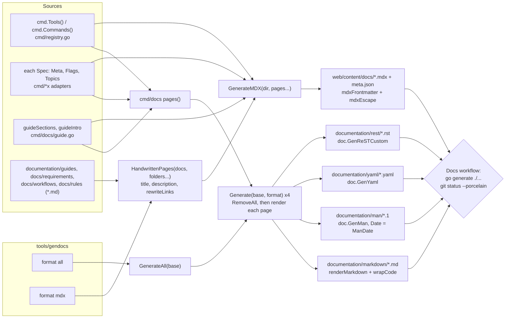

# Documentation Generation

How the reference documentation and the website's content are produced from the code: `tools/gendocs` (run by `make docs` and by the `go generate` lines in `main.go`) drives `cmd/docs`, which builds one page per topic from the tool registry and each tool's `docmeta.Meta`, renders it as markdown, man, YAML and reST into `documentation/<format>/`, and separately writes MDX pages plus Fumadocs `meta.json` navigation into `web/content/docs/`, together with the hand-written usage guides in `documentation/guides` (the requirements, workflows and rules are not published). It covers how output is kept byte-for-byte deterministic, how `wrapCode` and `mdxEscape` treat prose, how links in hand-written pages are rewritten for the website, and why none of the generated output is committed: the website build, the release and `make docs` each generate it from the code at hand.

## The path at a glance



## Step 1: the entry points

Three ways in, all ending at the same two calls:

```go
//go:generate go run ./tools/gendocs docs
//go:generate go run ./tools/gendocs web/content/docs mdx
```

```makefile
docs: ## Regenerate the reference (docs/, all formats) and the website content
	go run ./tools/gendocs docs all
	go run ./tools/gendocs $(WEB_DIR)/content/docs mdx
```

`tools/gendocs/main.go` takes `[dir] [format]` (defaults `docs` and `all`) and dispatches:

| `format`                    | Calls                                                          | Writes             |
|-----------------------------|----------------------------------------------------------------|--------------------|
| `all`                       | `docs.GenerateAll(dir)`                                        | `dir/{markdown,man,yaml,rest}/` |
| `markdown`, `man`, `yaml`, `rest` (also `md`, `yml`, `rst`) | `docs.Generate(dir, format)`   | `dir/<format>/`    |
| `mdx`                       | `docs.HandwrittenPages("documentation", "documentation", "guides")`, then `docs.GenerateMDX(dir, pages...)` | `dir/` directly |
| anything else               | `Generate` returns `unknown format "pdf" (want one of: ...)`   | nothing            |

The hand-written folders are read relative to the working directory, so gendocs must be run
from the repository root, as `make` and `go generate` do.

Why a separate program rather than a `gnux` subcommand: `cmd/docs` imports `cobra/doc`, which
pulls in `go-md2man`. Only `tools/gendocs` imports `cmd/docs`, so none of that links into the
`gnux` binary (NFR-40).

## Step 2: `pages()` builds every topic once

`pages()` in `cmd/docs/docs.go` returns the full, ordered list of pages, each carrying a cobra
command (for man, YAML and reST) and optionally a hand-rendered markdown function:

1. **`index`**: `cmd.NewRoot(core.Discard())`, the real root command, with
   `disableAutoGen` applied to it and every child. The `links` map rewrites cobra's child page
   names (`gnux_rmx`) to this layout (`rmx/index`).
2. **`guide`**: `guideCommand()` from `cmd/docs/guide.go`, a synthetic command whose `Long` is
   `guideLong()` (the `guideSections` as `TITLE. paragraph` prose) and whose flags match the
   root's.
3. **One page per entry of `cmd.Commands()`** (every tool, then `shell`), at `<name>/index`:
   the command is `topicCommand(t.Meta, ...)` with the tool's real flag set, built by
   `t.Command(discard).Flags()` so `--help` and `--version` appear exactly as at run time; the
   markdown is `toolMarkdown`.
4. **One page per `Topic`**, at `<name>/flags/<topic>` (only `rmx` declares topics, FR-83).

`topicCommand` exists because man, YAML and reST come from `cobra/doc`, which knows only a
command's `Long` and `Example`. It folds the metadata into those so every format carries the
same facts:

```go
long := m.Long
if m.Permissions != "" {
	long += "\n\nPERMISSIONS. " + m.Permissions
}
if len(m.UseCases) > 0 {
	long += "\n\nUSE CASES.\n"
	for _, u := range m.UseCases {
		long += "  - " + u + "\n"
	}
}
```

The examples become a plain indented block through `docmeta.ExampleBlock`, Bash only, since
those formats have a single example section. The markdown and MDX pages render both Bash and
PowerShell (FR-40).

Every page is built from the same `Meta` that `--help` prints, so the reference cannot describe
a tool that does not exist or a flag it does not have (FR-41).

## Step 3: `Generate` writes one format from scratch

```go
root := filepath.Join(base, format)
if err := os.RemoveAll(root); err != nil { ... }
for _, p := range pages() {
	writeFile(filepath.Join(root, p.dir), p.base+ext, func(w io.Writer) error { return render(p, w) })
}
```

Removing the directory first means a page for a removed tool or flag never lingers. It is also
why a hand edit to a generated file is lost on the next run.

| Format     | Renderer                                                     | Notes                                                    |
|------------|--------------------------------------------------------------|----------------------------------------------------------|
| `markdown` | `renderMarkdown`: `toolMarkdown`/`topicMarkdown` when present, else `doc.GenMarkdownCustom` with `tagMarkdownFences` | then `wrapCode`; links rewritten through `p.links` |
| `man`      | `doc.GenMan` with a `GenManHeader`: upper-case title, section `1`, source `gnux`, `Date: &ManDate` | stays plain: no `wrapCode`              |
| `yaml`     | `doc.GenYaml`                                                | for tooling                                              |
| `rest`     | `doc.GenReSTCustom`, with child links mapped to `<tool>/index.rst` | other refs as `:ref:`                              |

The markdown tool page (`toolMarkdown`) is hand-rendered because `cobra/doc` cannot produce
multi-section pages with language-tagged code blocks: it writes the summary, the
"Mirrors GNU `rm`" line, a `bash` synopsis, `topicBody` (description, permissions, use cases,
the flag table and per-shell examples), links to the per-flag pages and a "See also" section.

A run against the current tree writes 40 files per format: `index`, `guide`, 30 command pages
(29 tools and `shell`) and 8 `rmx` flag pages.

```text
$ go run ./tools/gendocs "$OUT" all
gendocs: wrote all reference to .../
$ for f in markdown man yaml rest; do echo "$f $(find "$OUT/$f" -type f | wc -l)"; done
markdown 33
man 33
yaml 33
rest 33
```

## Step 4: `wrapCode` (markdown and generated MDX only)

`Meta` strings are plain text, because they are also what `--help` prints in a terminal and what
man pages contain. `wrapCode` in `cmd/docs/markdown.go` adds backticks only when rendering
markdown, so the sources stay readable everywhere:

- It skips fenced blocks, headings (`#` lines), existing inline code and markdown links.
- `cmdPhraseRe` wraps phrases first: `go install`, `make build`, `docker compose`, `gnux shell`
  and similar.
- `cmdWordRe`, built once from the registry, wraps `gnux`, every tool name and every GNU name
  *except* `proseWords` (`cat`, `echo`, `env`, `false`, `head`, `sleep`, `tail`, `touch`,
  `true`, `yes`), which are ordinary English words. The x-names always wrap.
- `flagRefRe` wraps `-r`, `--force`, `--no-preserve-root`, but not hyphenated words like
  `write-protected`.
- Adjacent references merge, so "run gnux rmx -rf build" becomes "run `gnux rmx -rf` build".

`TestWrapCode` and `TestWrapCodeSkipsFencedBlocks` pin each rule; `TestGenerateAll` checks that
the markdown per-flag page wraps `--dir` and that the man page contains no backticks.

**Hand-written documents are not passed through `wrapCode`.** Their authors put code in
backticks themselves, as in this file.

## Step 5: the website content, `GenerateMDX`

`GenerateMDX(dir, extra...)` in `cmd/docs/mdx.go` also starts with `os.RemoveAll(dir)` and then
writes:

| File                        | Content                                                                  |
|-----------------------------|--------------------------------------------------------------------------|
| `index.mdx`                 | `guideIntro`, the three ways to use gnux, a table of every tool          |
| `guide.mdx`                 | `guideSections` as real `##` headings, then the examples                 |
| `library.mdx`               | the `mdxLibrary` constant: engines, streams, errors, `RunTool`, `NewShell` |
| `shell.mdx`                 | `mdxTool(cmd.ShellSpec(), ...)`                                          |
| `tools/<tool>/index.mdx`    | `mdxTool` for each of `cmd.Tools()`, linking to its option pages         |
| `tools/<tool>/<flag>.mdx`   | `flagPages` (`mdx_flags.go`): one page per option, or per `Topic`, with its usage, details and the tool's examples that pass it |
| `<folder>/<page>.mdx`       | each hand-written `Page`                                                 |
| `meta.json`, `tools/meta.json`, `tools/<tool>/meta.json`, `<folder>/meta.json` | Fumadocs navigation: title and page order. The root lists each hand-written folder as a `"---Guides---"` heading followed by its pages by path (its index page left out), then `"---Tools---"` and `"...tools"`, so nothing is a collapsible section and the guides come before the tools |

Every page starts with frontmatter from `mdxFrontmatter`, which uses `json.Marshal` for both
values: a JSON string is a valid YAML scalar, so titles with quotes or colons need no special
handling.

```text
---
title: "SRS Workflows"
description: "The user-facing workflows of gnux as step-by-step flows: ..."
---
```

Generated pages are `mdxEscape(wrapCode(body))`; hand-written pages are
`mdxEscape(stripTitle(markdown))`, with the `# Title` line dropped because the site renders the
title from the frontmatter.

### `mdxEscape`

MDX reads `{` as the start of a JavaScript expression and `<` as the start of a JSX tag, so
prose like `${NAME}` or `<file>` would break the build. `mdxEscape` replaces `{`, `}` and `<`
with `\{`, `\}` and `\<` **outside** fenced blocks and inline code spans, which are literal in
MDX already:

```text
in:  use ${NAME} or <file> but not `${code}`
out: use $\{NAME\} or \<file> but not `${code}`
```

`TestMDXEscape` pins this, and `TestGenerateMDX` scans every generated page for an unescaped
brace or angle bracket outside code. Practical consequence for authors: put such characters in
a code span or a fenced block, where they render exactly as typed. Mermaid diagrams in fenced
`mermaid` blocks are untouched for the same reason.

### Navigation order

The top-level `meta.json` lists `index`, `guide`, `shell`, `library`, `tools`, then each
hand-written folder in the order its first page appeared. Each hand-written folder gets its own
`meta.json` whose title is `folderTitle(folder)` ("workflows" becomes "Workflows") and whose
pages are in the order `HandwrittenPages` returned them.

## Step 6: hand-written pages, `HandwrittenPages`

`HandwrittenPages(docsRoot, folders...)` in `cmd/docs/handwritten.go` reads each folder that
exists (a missing one is skipped, which is how a folder can be added before it has content):

1. **Collect** the `.md` files, ignoring everything else (`TestHandwrittenPages` puts a
   `notes.txt` beside them).
2. **Order**: `README.md` first, as the folder's `index` page; the rest alphabetically. File
   names are the URL slugs, which is why they are lower-case and hyphenated.
3. **Rewrite links** (below).
4. **Title** = the first `# ` line. **Description** = the first paragraph after it, as plain
   text: it stops at a blank line or at the first structural line (`#`, `|`, a code fence,
   `- `, `---`), reduces each inline link to its text, and strips `*`, `_` and backticks.

That is the reason every hand-written document, this one included, starts with exactly one
`# Title` and a one-paragraph prose summary: the summary *is* the page's description on the
website and in search results (FR-82).

### Link rewriting

`rewriteLinks` resolves each relative link against `documentation/<folder>/` (the `repoPath` given to `HandwrittenPages`) and decides where it should
point once published:

The table follows `TestHandwrittenPages`, which publishes two folders (`requirements` and
`rules`) to exercise both kinds of link. The real site publishes only `guides`, so from a guide
a link into `../requirements/` takes the GitHub row, not the site row.

| Link in `docs/rules/one-rule.md`                    | Becomes                                                        | Why                                     |
|-----------------------------------------------------|----------------------------------------------------------------|-----------------------------------------|
| `README.md`                                         | `/docs/rules`                                                  | a README is its folder's index          |
| `../requirements/functional-requirements.md#fr-1`   | `/docs/requirements/functional-requirements#fr-1`              | a published page; the anchor is kept    |
| `../../AGENTS.md`                                   | `https://github.com/braswelljr/gnux/blob/main/AGENTS.md`       | not published: link to GitHub           |
| `../../core/core.go`                                | `https://github.com/braswelljr/gnux/blob/main/core/core.go`    | source code: link to GitHub             |
| `https://gnux.vercel.app/docs/tools/rmx#examples`   | `/docs/tools/rmx#examples`                                     | a reference page: stays on the site, and on the version being read |
| `../../documentation/markdown/rmx/index.md`         | `/docs/tools/rmx`                                              | the same page; prefer the website URL, which also works on GitHub |
| `https://example.com/x.md`, `#top`, `/x`, `mailto:` | unchanged                                                      | already absolute or in-page             |

Only a `.md` file **directly inside** one of the published folders becomes a site link. These
are exactly the cases `TestHandwrittenPages` asserts. The link pattern accepts one level of
balanced parentheses in a target, so a link into a Next.js route group such as
`web/src/app/(home)/page.tsx` survives.

## Determinism

Two runs over the same code must give the same files (NFR-29), so that the website and the
release archives built from one commit carry the same reference. What keeps them stable:

| Source of churn                     | How it is removed                                                    |
|-------------------------------------|----------------------------------------------------------------------|
| cobra's "Auto generated by spf13/cobra on DATE" footer | `DisableAutoGenTag` on every command (`disableAutoGen`, `topicCommand`, `guideCommand`) |
| The man page date                   | `docs.ManDate`, fixed at 1 January 2024 (`.TH "RMX" "1" "Jan 2024" "gnux" "gnux manual"`) |
| Page order                          | `Tools()` order (alphabetical), README-then-alphabetical for hand-written pages |
| Stale files                         | Each output directory is removed and rebuilt                         |
| Version strings                     | No page includes `common.Version`                                    |

`TestGenerateAllDeterministic` generates the four formats twice into separate directories and
compares the trees file by file. The MDX output has no such test; its stability rests on the
same rules.

`ManDate` is a package variable rather than a constant so release tooling could set it before
generating; nothing does today, so release man pages carry the pinned date (see
[ci-and-release](ci-and-release.md)).

## Step 7: nothing generated is committed

`.gitignore` keeps `documentation/{markdown,man,yaml,rest}/` and `web/content/docs/` out of the
repository, the docs of past releases included: each release carries its own as
`gnux-docs-vX.Y.Z.tar.gz` (`tools/docsnap`, run by GoReleaser), and the website's build
downloads and unpacks them (`web/scripts/docs-versions.mjs`). Each consumer generates what it
needs:

| Consumer                     | Generates                                  | How                                              |
|------------------------------|--------------------------------------------|--------------------------------------------------|
| The website (`pnpm dev`, `pnpm build`, Vercel) | `web/content/docs` (MDX), and `web/public/reference/yaml`, served at `/reference/yaml/` and listed in `llms.txt` | `web/scripts/gen.mjs`, downloading Go when the host has none |
| A release                    | `documentation/man`, shipped in the Unix archives | the `before` hook in `.goreleaser.yaml`  |
| The Docs workflow            | every format, plus the MDX                 | `go generate ./...`; the markdown and man pages are kept as the run's `reference` artifact |
| The Web workflow             | the MDX and the YAML reference             | `make web/docs`, before linting and type-checking |
| A contributor                | every format, plus the MDX                 | `make docs` (part of `make ci`)                  |

`.github/workflows/docs.yml` runs on pushes and pull requests to `main` that touch `**.go`,
`documentation/guides/**`, `CHANGELOG.md`, `tools/**` or `go.mod`:

```bash
go test ./cmd/docs/... ./tools/gendocs/...
go generate ./...
```

A hand-written document links to a reference page by its website URL, never into
`documentation/markdown/`, which exists only where someone ran `make docs` (FR-41, FR-46).

## Tests that pin this workflow

| Test (`cmd/docs/docs_test.go`)        | What it proves                                                       | Requirement |
|---------------------------------------|----------------------------------------------------------------------|-------------|
| `TestGenerateAll`                     | a non-empty page per command in every format; flag pages; markdown wraps, man stays plain | FR-39, FR-42, FR-83 |
| `TestMarkdownLinksResolve`            | every relative link in the markdown tree points at a written file   | FR-42       |
| `TestGenerateUnknownFormat`           | an unknown format is an error                                        |             |
| `TestGenerateAllDeterministic`        | two runs produce identical trees                                     | NFR-29      |
| `TestGenerateMDX`                     | a page per tool, frontmatter, no unescaped MDX characters, extra folders in navigation | FR-46, FR-82 |
| `TestMDXEscape`, `TestWrapCode`, `TestWrapCodeSkipsFencedBlocks`, `TestFenceLang` | the prose transformations      |             |
| `TestHandwrittenPages`                | ordering, title and description extraction, link rewriting          | FR-82       |
| Docs workflow, `make docs`            | the reference and the website content generate from the code        | FR-41, FR-46 |

## Common failures

| Symptom                                                        | Cause                                                       | Fix                                                       |
|----------------------------------------------------------------|-------------------------------------------------------------|-----------------------------------------------------------|
| A hand edit under `documentation/markdown` vanished                     | The format directory is rebuilt from scratch                | Change the tool's `Meta()` or `Register` instead          |
| A hand-written page breaks on the website after a code block   | An unclosed code fence: `mdxEscape` treats everything after it as code and stops escaping | Close every fence; `TestGenerateMDX` reports "unbalanced code fence" for the pages it generates |
| A hand-written page's description is cut short or empty        | The first paragraph starts with a list, table or code fence, or there is none | Start with one prose paragraph after the title |
| A link on the website goes to GitHub instead of the site       | The target is not a `.md` directly inside a published folder, nor a website URL | Link to the published document or the page's website URL, or accept the GitHub link |

## Related

- User-facing flow: WF-8 in [srs-workflows](../requirements/srs-workflows.md).
- [ci-and-release](ci-and-release.md) for the Docs workflow in context.
- [adding-a-tool](adding-a-tool.md), whose registration is what puts a tool in the reference.
- The rules: [rules](../rules/README.md).
