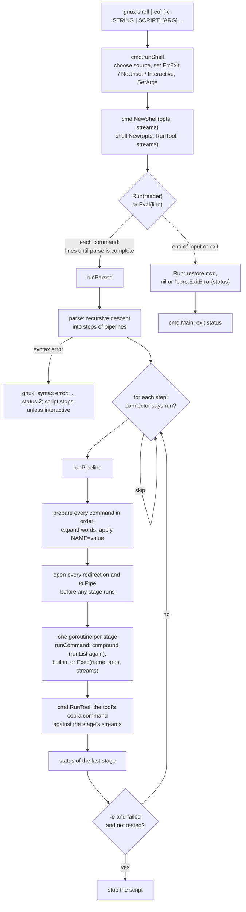

# Shell Execution

How `gnux shell` turns source text into an exit status: `cmd/shell.go` picks the script source and options, `core/shell/shell.go` reads it a command at a time (a line, or the several an `if`, a loop, a `case` or a `$(...)` spans), `parse.go` lexes and parses that into steps of pipelines whose commands may be compound, `expand.go` expands variables, script arguments, command substitutions, tildes and globs, and `shell.go` sets up redirections and pipes for every stage before any stage starts, runs the stages as goroutines joined by `io.Pipe`, and reaches the tools only through an injected `Exec` function that `cmd.NewShell` wires to `cmd.RunTool`. It covers the `&&`, `||` and `;` connectors, `if`, `for`, `while` and `case`, `-e` and `-u`, how a closed pipe becomes `EPIPE`, `cd` and the process working directory, and the difference between `Run` for a whole script and `Eval` for one command of a session.

## The path at a glance



## Step 1: `gnux shell` chooses the source

`ShellSpec()` in `cmd/shell.go` is an ordinary `tool.Spec` with no `GNU` name, so it is in
`Commands()` (a subcommand of `gnux`) but not in `Tools()` (no `argv[0]` dispatch, not in
`--list`) (FR-77). Its `DiagName` is `gnux shell`, and its `UsageExit` is 2, the status `sh`
uses for a bad invocation.

`runShell` picks the script source:

| Invocation               | Source                         | Interactive?                     |
|--------------------------|--------------------------------|----------------------------------|
| `gnux shell -c STRING`   | `strings.NewReader(STRING)`    | no                               |
| `gnux shell SCRIPT`      | `os.Open(SCRIPT)`              | no                               |
| `gnux shell`             | `s.In`                         | `core.IsTerminal(s.In)`          |

Operands after the source are the script's arguments (FR-153): `runShell` passes them to
`sh.SetArgs(name, params)`. After `SCRIPT`, `$0` is the script's path and the rest are `$1`,
`$2`, ...; after `-c STRING`, the first operand is `$0`, as in sh. The spec sets
`NoInterspersed`, so option parsing stops at `SCRIPT` and `gnux shell build.gnux -v` hands `-v`
to the script.

A missing script file is not a usage error: it prints `gnux: FILE: No such file or directory` and
returns `&core.ExitError{Code: 127}`, the status `sh` uses for a script it cannot find. An
unknown option is a usage error with status 2 (FR-23):

```text
$ gnux shell --nosuch
gnux shell: unknown flag: --nosuch
Try 'gnux shell --help' for more information.     # status 2
$ gnux shell missing.gnux
gnux: missing.gnux: No such file or directory     # status 127
```

`-e` sets `shell.Options.ErrExit` and `-u` sets `NoUnset`. Then `sh.Run(script)`.

## Step 2: `NewShell` injects the command set

```go
func NewShell(opts shell.Options, s core.Streams) *shell.Shell {
	return shell.New(opts, RunTool, s)
}
```

`core/shell` never imports `cmd`. It defines

```go
type ExecFunc func(name string, args []string, s core.Streams) (status int, found bool)
```

and reaches tools only through `Shell.Exec`. That keeps the import graph one-way (`cmd` depends
on `core/shell`, never the reverse), lets `core/shell/shell_test.go` test the interpreter
against a fake command set (`fakeExec`: `echo`, `cat`, `upper`, `spam`, `fail`, ...), and lets a
library caller restrict or extend what a script may run. `cmd.RunTool` matches the signature
exactly, and since it is `Lookup` plus a fresh cobra command, the shell accepts both names:
`rm` and `rmx` are the same command.

`shell.New` also sets `Getenv: os.Getenv` and `HomeDir: os.UserHomeDir` as injection points, and
an empty variable map.

## Step 3: `Run` reads commands; `Eval` runs one

```go
reader := core.NewReader(r)
pending := ""
for !sh.exited {
	if sh.Interactive { /* Prompt "gnux> ", or ContinuePrompt "> " while pending != "" */ }
	line, err := reader.ReadString('\n')
	if line != "" { pending += strings.TrimRight(line, "\r\n") + "\n" }
	if pending != "" {
		steps, perr := parse(pending)
		if err != nil || !incomplete(perr) {   // whole, wrong, or out of input
			pending = ""
			sh.runParsed(steps, perr)
		}
	}
	if err != nil { /* EOF ends the loop; other errors: status 1 */ break }
}
```

- **A command is run as soon as it is whole.** Most are one line. A line that opens an `if`, a
  loop, a `case` or a `$(` makes `parse` fail with a `*syntaxError` whose `incomplete` field is
  set; `Run` then keeps the text and reads another line. Each command is run before the next is
  read, so an interactive session responds as it goes and a script's side effects happen in
  order. At the end of the input an unfinished command is an ordinary syntax error
  (`expected 'fi'`).
- **Only a construct that says so spans lines.** An unterminated quote, and a line ending in
  `|`, `&&` or `||`, are errors on that line and never `incomplete`: a typo must not swallow
  the rest of the script.
- **`\r\n` is trimmed,** so a script saved with Windows line endings runs unchanged (FR-29).
- **The prompt goes to standard error,** so `gnux shell > out.txt` captures only command output.
- **The working directory is restored** when `Run` returns (NFR-16): `cd` changes the whole
  process's directory (step 9), and a Go program that runs a script must not find itself
  somewhere else afterwards.
- **The result is an `*core.ExitError`** carrying the last status, so `cmd.Main` exits with it
  silently (FR-27).

`Eval(line)` is the session form used by the playground (FR-81, FR-85). It parses its whole
argument, which may hold several lines, and runs it. It keeps everything between calls
(variables, `$?`, the working directory) and does not restore the directory. `exit` ends only
that call, since a host such as a web page has nowhere to exit to. `TestEvalKeepsState` pins
this. `shell.Incomplete(src)` answers, for a host that reads one line at a time, whether to ask
for another before calling `Eval`.

## Step 4: lexing and parsing (`parse.go`)

`parse(src)` is a recursive-descent parser with one token of lookahead; the lexer runs on
demand (`parser.lex`). Errors are raised with `fail` (a panic carrying a `*syntaxError`) and
recovered in `parse`.

### Lexing

`lex` produces one token: a **word**, an **operator**, a line break, or the end of the input.

- Operators are matched longest first: `&&`, `||`, `>>`, `;;`, `|`, `;`, `<`, `>`, `(`, `)`.
  `2>` and `2>>` are operators only at the *start* of a word, so `a2>b` keeps the `2` in the
  word.
- A word is a list of **parts**, each tagged with how it was quoted, because quoting decides
  expansion:

  | Written as        | Part mode  | Variables | Globbing |
  |-------------------|------------|-----------|----------|
  | plain text        | `raw`      | yes       | yes      |
  | `"double"`        | `double`   | yes       | no       |
  | `'single'`, `\x`  | `literal`  | no        | no       |
  | `$(commands)`     | `subst`, in `raw` or `double` | its own | no |

  So `a"$b"'c'` is one word of three parts. An empty quoted string still adds a part, so `''`
  is an argument.
- **`$(` is parsed where it stands.** The lexer starts a second `parser` on the same source just
  after the `$(`, lets it parse a list up to the matching `)`, stores the steps in the part and
  carries on from where it stopped. Nesting, quotes inside, and a `case` pattern's own `)` all
  fall out of that, with no bracket counting.
- A backslash escapes only a character in `special` (`` \t"'$\|&;<>()*?[#~`` and space). Any
  other backslash is kept, which is why `C:\tools\bin` survives unquoted (FR-24). Inside double
  quotes a backslash escapes only `"`, `$` and `\`.
- `#` at the start of a token begins a comment to the end of the line.
- A quote that reaches the end of its line is a syntax error.

### Parsing

```text
list     := (pipeline (('&&' | '||') pipeline)*) separated by ';' or newlines
pipeline := ['!'] command ('|' command)*
command  := word... redirect...                       a simple command
          | (if | for | while | case) redirect...     a compound command
```

`list` returns `[]step`, where a `step` is a `pipeline` plus the connector before it (`""`,
`;`, `&&` or `||`). A `pipeline` is its commands and a `negate` flag; a `command` is its words
and redirections, or a `compound` (`*ifClause`, `*forClause`, `*whileClause`, `*caseClause`)
whose bodies are lists again.

The reserved words (`if then elif else fi for while do done case esac`) mean something only as
the first word of a command, so `echox done` prints `done`. `list` stops at whatever could close
it (the end of the input, `)`, `;;`, or a closing word), and its caller checks that it is the
right one: `expected 'then', found 'fi'`. `;;` ends a `case` arm; outside a `case` it is two
harmless semicolons, as it always was.

A pipeline may hold at most one compound command, which the parser refuses otherwise: its
stages run at the same time, and a compound command reads and writes the shell's variables as it
goes (step 7).

Other errors: `expected a file name after '>'`, `redirection without a command`,
`unexpected '|'`, `unexpected '('`, and `expected a command after '&&'`.

On any syntax error `runParsed` writes `gnux: syntax error: ...`, sets status 2, and, unless the
shell is interactive, sets `exited` so the script stops: a script with a syntax error cannot be
trusted to mean what its author intended (FR-27).

```text
$ gnux shell -c 'echox "unterminated'
gnux: syntax error: unterminated double quote     # status 2
$ gnux shell -c 'if truex; then echox a'
gnux: syntax error: expected 'fi'                 # status 2
```

## Step 5: lists, connectors and `-e` (`runList`)

```go
for i, st := range steps {
	if sh.stopped() { return }      // exit, an abort, or a break/continue on its way out
	switch st.connector {
	case "&&": if sh.status != 0 { continue }
	case "||": if sh.status == 0 { continue }
	}
	sh.status = sh.runPipeline(st.pipeline, s)
	tested := sh.testing > 0 || st.pipeline.negate ||
		(i+1 < len(steps) && (steps[i+1].connector == "&&" || steps[i+1].connector == "||"))
	if sh.ErrExit && sh.status != 0 && !tested {
		sh.exited = true
	}
}
```

`runList` runs the top-level commands and every body of a compound command. The streams are a
parameter all the way down, never a field, so a redirected loop hands its file to every command
inside it and the shell's own diagnostics (`command not found`) follow the command's standard
error.

The `tested` rule is `set -e`'s: a status that something tests is a condition, not a failure
(FR-28). That is a command before `&&` or `||`, a pipeline after `!`, and anything run while
`sh.testing` is positive, which `test` raises around the condition of an `if` or a `while`.
Real output:

```text
$ gnux shell -c 'echox ok && nosuch; echox "after $?"'
ok
gnux: nosuch: command not found
after 127
$ gnux shell -c 'falsex || echox recovered'
recovered                                          # status 0
$ printf 'falsex\necho never\n' > s.gnux; gnux shell -e s.gnux
                                                   # status 1, "never" not printed
$ gnux shell -e -c 'if falsex; then echox no; fi; echox after'
after                                              # the condition may fail
```

## Step 6: expansion (`expand.go`), done before anything runs

`runStages` first calls `prepare` on **every** command of the pipeline, in order, on the
calling goroutine. `prepare` builds an `expander` (the shell, the command's streams, and what
went wrong), sets aside the leading `NAME=value` words, expands the remaining words with
`fields`, then applies the assignments in order with `single`, then expands each redirection
target (more than one word marks the command `ambiguous`). That order is sh's: `X=1 echox $X`
sees the old `X`, while `A=1 B=$A` sees the new `A`.

`expand` handles a word part by part and has two modes. `fields` may produce several arguments
and globs; `single` (assignments, the word a `case` tests) and `pattern` (a `case` pattern)
produce exactly one string and never glob.

1. A leading `~` or `~/` in the first raw part becomes `HomeDir()`.
2. `vars` replaces `$NAME`, `${NAME}`, `${NAME:-default}`, `$1` to `$9`, `${10}`, `$?`, `$#`,
   `$0`, `$@` and `$*`, returning **segments tagged with whether they came from a variable**.
   `lookup` resolves the special ones first, then shell variables, then `$PWD` (the live
   `os.Getwd()`, so it follows `cd`), then `Getenv`, and says whether anything defined the name.
3. Raw text the user typed that contains `*`, `?` or `[` turns on globbing. Text from a
   variable, and any quoted text, is added to the pattern through `globEscape`, which wraps each
   metacharacter in a bracket expression (`[*]`), the only escape `filepath.Match` honors on
   every platform.
4. If globbing is on and `Glob` matches, the sorted matches replace the word; a pattern that
   matches nothing is passed through unchanged, as in POSIX `sh`.

So a variable's value is never re-split or re-globbed (FR-78): a path with spaces stays one
argument once stored, and a file literally named `*.go` held in a variable stays itself. Only
two things turn one word into several arguments: `$@`, one per script argument (none at all when
there are none, quoted or not), and an unquoted `$(...)`, one per non-empty line of output.

```text
$ gnux shell -c 'X="has space"; echox $X'
has space
```

**`-u` (FR-154).** When `NoUnset` is on and `lookup` reports a name as not set, `vars` writes
`gnux: NAME: unbound variable` and marks the expander `failed`. The command is not run, its
status is 1, and `abort` ends the script (an interactive session loses only that command).
`${NAME:-default}` never fails, and neither do `$?`, `$#`, `$0`, `$@` and `$*`. The shell's
`Getenv` cannot tell an empty environment variable from a missing one, so an empty one counts as
unset.

**Command substitution (FR-155).** `substitute` runs the part's steps through `runList` with
standard output pointed at a buffer, then strips the trailing newlines. It is a subshell in
effect: `save` copies the variables, the arguments, the options and the exit flags beforehand and
`restore` puts them back, and the working directory is put back with `os.Chdir`, so
`$(cd .. && pwdx)` works and leaves the script where it was. The status of the last
substitution is kept on the expander, and is what a command of only assignments returns:
`X=$(falsex)` fails, which `-e` acts on.

Why all of this happens before any stage starts: expansion reads and writes shell state (`vars`,
`status`), and that state is not goroutine-safe. Doing it in order, on one goroutine, means no
stage ever races another over a variable. One visible consequence differs from `sh`, where each
pipeline stage is a subshell: here an assignment in an early stage is seen by a later one, so
`A=1 | echox $A` prints `1`.

`NAME=value cmd` deliberately sets the variable for the rest of the script, not only for `cmd`
(FR-78); `cmd` receives no environment change. To pass an environment to an external program,
use `envx NAME=value program`.

## Step 7: compound commands (`runCompound`)

`runCommand` hands a command that has a `compound` to `runCompound`, with the command's
(already redirected) streams:

| Construct | How it runs |
|-----------|-------------|
| `if`      | `test` runs each condition in turn (`sh.testing` raised) until one succeeds, then `runBody` runs that branch, or the `else` |
| `for`     | the items are expanded once with `fields` (or are the script's arguments when there is no `in`), then `loop` sets the variable and runs the body for each |
| `while`   | `loop` runs the body for as long as `test` of the condition succeeds |
| `case`    | the word is expanded with `single`, each pattern with `pattern`, and `match` picks the first arm that fits |

Its status is that of the last command it ran, and 0 when it ran none.

`loop` is shared by `for` and `while`. `break [N]` and `continue [N]` are builtins that set
`sh.breaking` or `sh.continuing` to the number of loops to leave; `stopped()` then makes every
`runList` on the way out return, and each `loop` it passes takes one off the count.
`Shell.LoopLimit`, when set, stops a loop after that many turns: the playground sets it,
because nothing can interrupt a script in a browser tab.

`match` is the shell's own pattern matcher (`*`, `?`, `[...]` with ranges and `!`). It is not
`filepath.Match`, whose `*` stops at a separator and whose rules differ on Windows: a `case`
pattern matches text, not a path.

**In a pipeline** a compound command is one stage among the others (`for ...; done | sortx`).
Its body runs on its stage's goroutine while the goroutine that started the pipeline waits, and
the parser allows only one per pipeline, so the shell's state still has one user at a time. It
is a subshell in effect: `runStages` saves the state before the stages start and restores it
after they end.

## Step 8: redirections and pipes, then the stages

### A single command

A one-command pipeline runs on the current goroutine:

```go
p := sh.prepare(cmds[0], base)
s, closeFiles, ok := sh.open(p, base)
defer closeFiles()
return sh.runCommand(cmds[0], p, s, ok, false)
```

### A real pipeline

For two or more commands, `runStages`:

1. prepares every command (step 6);
2. for every stage, **before any stage runs**, creates the `io.Pipe` to the next stage (the
   write end wrapped in `pipeWriter`) and opens that stage's redirections with `sh.open`;
3. starts one goroutine per stage, each running `runCommand` against its own streams, then
   closing its pipe write end and the read end it consumed;
4. waits for all of them and returns the **last** stage's status (FR-79).

Opening every redirection first is the order a POSIX shell guarantees: a file that a later stage
creates already exists when an earlier stage looks. The comment in the code uses this example,
and the real binary shows it, `count` being listed by `lsx` because `> count` was opened first:

```text
$ ls
s.gnux
$ gnux shell -c 'lsx | wcx -l > count; catx count'
2
```

`redirect` opens `<` read-only, `>` and `2>` with `O_TRUNC`, `>>` and `2>>` with `O_APPEND`,
all with mode `0644`. `/dev/null` is never opened: it is mapped to an empty reader or
`io.Discard`, so scripts that use it work on Windows and in the browser, where no such file
exists (FR-29). A redirection that fails is reported (`gnux: PATH: Permission denied`) and the
command is not run; its status is 1.

### Closing pipes and `EPIPE`

When a stage finishes, closing its write end tells the next stage "end of input", and closing
the read end it consumed tells the stage upstream "nobody is listening". A further write
upstream then fails with `io.ErrClosedPipe`, which `pipeWriter` translates:

```go
func (p pipeWriter) Write(b []byte) (int, error) {
	n, err := p.w.Write(b)
	if errors.Is(err, io.ErrClosedPipe) {
		err = syscall.EPIPE
	}
	return n, err
}
```

`EPIPE` is the error a tool sees from a real OS pipe, and every streaming engine already treats
it as a quiet reason to stop (NFR-14; see
[error-handling-and-exit-status](error-handling-and-exit-status.md#closed-pipes)). That is what
ends an endless producer:

```text
$ gnux shell -c 'yesx | headx -n 2; echox $?'
y
y
0
```

There are no OS processes and no signals here. Each stage is a goroutine calling a Go function,
so `SIGPIPE` cannot exist; `EPIPE` is the in-process stand-in.

## Step 9: `runCommand`, builtins and tools

```go
if cmd.compound != nil { return sh.runCompound(cmd.compound, s) }
switch name {
case "cd":   return sh.cd(args, s, piped || sh.subshell > 0)
case "exit": return sh.exit(args, s, p.last, piped)
case "set", "shift", "break", "continue":
	if piped { return 0 }
	return sh.builtin(name, args, s)
case "help": fmt.Fprint(s.Out, helpText); return 0
case "[":    name, args = "test", args[:len(args)-1]   // after checking the closing ]
}
if status, found := sh.Exec(name, args, s); found {
	return status
}
sh.errorf(s, "%s: command not found", name)
return 127
```

- **No external programs** are ever looked up (NFR-18). An unknown name is
  `gnux: NAME: command not found` and status 127. `envx PROGRAM ARG...` is the explicit way out.
- **`cd`** with no argument goes to `HomeDir()`. Outside a pipeline it calls `os.Chdir`, which
  is process-wide on purpose: every tool resolves relative paths against the process working
  directory, so the shell has no private notion of one. Inside a multi-stage pipeline (`piped`)
  it only checks the directory exists, as a subshell's `cd` would not affect the parent.
- **`exit [N]`** sets the status (`N & 0xff`; a non-number is `numeric argument required` and
  status 2) and, outside a pipeline, ends the script.
- **`set`** turns `-e` and `-u` on (`+e`, `+u` off) and, as `set -- ARG...`, replaces the
  script's arguments; **`shift [N]`** drops the first N. **`[ EXPRESSION ]`** is the `test`
  tool under the name scripts use, reached through `Exec` like any other.
- **A tool** runs through `Exec`, which for `gnux shell` is `cmd.RunTool`: a fresh cobra command,
  flag parsing, the adapter, the engine, and the exit-status mapping, exactly as in
  [command-line-to-tool-run](command-line-to-tool-run.md). Usage errors and diagnostics are
  written to the stage's own stderr stream, which may be redirected.

## Exit status of the shell

| Situation                               | Status            | Requirement |
|-----------------------------------------|-------------------|-------------|
| The last command run                    | its status        | FR-27       |
| A syntax error                          | 2, script stops   | FR-27       |
| An unknown command                      | 127               | FR-27, NFR-18 |
| `-e` and an untested failure            | that status, script stops | FR-28 |
| `-u` and a variable that is not set     | 1, script stops   | FR-154      |
| A bad `gnux shell` invocation           | 2 (`UsageExit`)   | FR-6        |
| A script file that cannot be opened     | 127               | FR-23       |

## Tests that pin this workflow

| Test                                                         | What it proves                                         |
|--------------------------------------------------------------|--------------------------------------------------------|
| `TestScripts` (`core/shell/shell_test.go`)                   | quoting, expansion, connectors, pipelines (FR-24, FR-78, FR-79) |
| `TestRedirection`                                            | `<`, `>`, `>>`, `2>`, `/dev/null`, setup order         |
| `TestGlob`                                                   | globbing and the no-re-glob rule                       |
| `TestErrExit`                                                | `-e` and the tested-status exemption (FR-28)           |
| `TestSyntaxErrors`, `TestDiagnostics`                        | status 2 and 127, no external programs (FR-27, NFR-18) |
| `TestCd`, `TestEvalKeepsState`                               | process-wide `cd`, restored by `Run`, kept by `Eval` (NFR-16, FR-81) |
| `TestSetAndHelp`                                             | `Set` and the `help` builtin (FR-26)                   |
| `TestControlFlow` (`core/shell/control_test.go`)             | `if`, `for`, `while`, `case`, `!`, `[`, `break`, `continue`, a loop in a pipeline (FR-152) |
| `TestSubstitution`                                           | `$(...)`: line splitting, quoting, nesting, subshell, `cd` put back (FR-155) |
| `TestParameters`                                             | `$1`, `$#`, `$@`, `$*`, `shift`, `set --`, `${NAME:-default}`, assignment order (FR-153) |
| `TestNoUnset`                                                | `-u` and `set -u`, everywhere a variable is read (FR-154) |
| `TestErrExitAndConditions`                                   | what `-e` exempts, and `set -e` (FR-28)                |
| `TestControlSyntaxErrors`, `TestContinuation`                | the errors of the new syntax; commands that span lines, `ContinuePrompt`, `Incomplete` |
| `TestCompoundRedirection`, `TestLoopLimit`                   | redirecting a whole loop; `LoopLimit`                  |
| `FuzzParse`, `FuzzRun` (`core/shell/fuzz_test.go`)           | no text makes the parser or the interpreter panic (NFR-48) |
| `TestShellCommand` (`cmd/shell_test.go`)                     | `-c`, script files and their arguments, `-u`, control flow with the real tools, status propagation, usage errors, "shell is not a tool" (FR-23, FR-77, FR-152 to FR-155) |
| `TestNewShell` (`cmd/shell_test.go`)                         | the library entry point with the real tools (FR-35)    |

## Related

- User-facing flow: WF-3 and WF-5 in [srs-workflows](../requirements/srs-workflows.md).
- The browser host for `Eval`: [wasm-playground](wasm-playground.md).
- The shell's requirements: section 5 of
  [functional-requirements](../requirements/functional-requirements.md).
- The [rules](../rules/README.md) and the [guides](../../documentation/guides/README.md).
