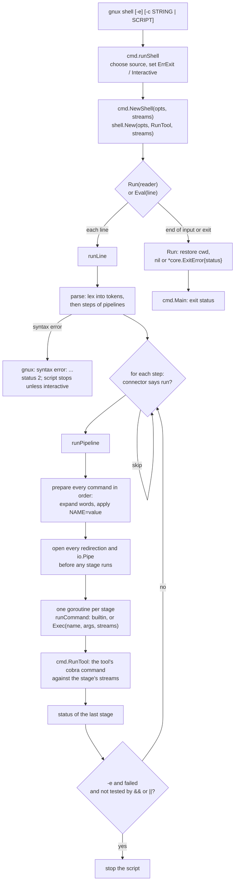

# Shell Execution

How `gnux shell` turns source text into an exit status: `cmd/shell.go` picks the script source and options, `core/shell/shell.go` reads it line by line, `parse.go` lexes and parses each line into steps of pipelines, `expand.go` expands variables, tildes and globs, and `shell.go` sets up redirections and pipes for every stage before any stage starts, runs the stages as goroutines joined by `io.Pipe`, and reaches the tools only through an injected `Exec` function that `cmd.NewShell` wires to `cmd.RunTool`. It covers the `&&`, `||` and `;` connectors, `-e`, how a closed pipe becomes `EPIPE`, `cd` and the process working directory, and the difference between `Run` for a whole script and `Eval` for one line of a session.

## The path at a glance



## Step 1: `gnux shell` chooses the source

`ShellSpec()` in `cmd/shell.go` is an ordinary `tool.Spec` with no `GNU` name, so it is in
`Commands()` (a subcommand of `gnux`) but not in `Tools()` (no `argv[0]` dispatch, not in
`--list`) (FR-77). Its `DiagName` is `gnux shell`, and its `UsageExit` is 2, the status `sh`
uses for a bad invocation.

`runShell` picks the script source:

| Invocation               | Source                         | Interactive?                     |
|--------------------------|--------------------------------|----------------------------------|
| `gnux shell -c STRING`   | `strings.NewReader(STRING)`    | no                               |
| `gnux shell SCRIPT`      | `os.Open(SCRIPT)`              | no                               |
| `gnux shell`             | `s.In`                         | `core.IsTerminal(s.In)`          |

A missing script file is not a usage error: it prints `gnux: FILE: No such file or directory` and
returns `&core.ExitError{Code: 127}`, the status `sh` uses for a script it cannot find. Extra
operands are usage errors with status 2 (FR-23):

```text
$ gnux shell a b
gnux shell: extra operand 'b'
Try 'gnux shell --help' for more information.     # status 2
$ gnux shell missing.gnux
gnux: missing.gnux: No such file or directory     # status 127
```

`-e` sets `shell.Options.ErrExit`. Then `NewShell(opts, s).Run(script)`.

## Step 2: `NewShell` injects the command set

```go
func NewShell(opts shell.Options, s core.Streams) *shell.Shell {
	return shell.New(opts, RunTool, s)
}
```

`core/shell` never imports `cmd`. It defines

```go
type ExecFunc func(name string, args []string, s core.Streams) (status int, found bool)
```

and reaches tools only through `Shell.Exec`. That keeps the import graph one-way (`cmd` depends
on `core/shell`, never the reverse), lets `core/shell/shell_test.go` test the interpreter
against a fake command set (`fakeExec`: `echo`, `cat`, `upper`, `spam`, `fail`, ...), and lets a
library caller restrict or extend what a script may run. `cmd.RunTool` matches the signature
exactly, and since it is `Lookup` plus a fresh cobra command, the shell accepts both names:
`rm` and `rmx` are the same command.

`shell.New` also sets `Getenv: os.Getenv` and `HomeDir: os.UserHomeDir` as injection points, and
an empty variable map.

## Step 3: `Run` reads lines; `Eval` runs one

```go
func (sh *Shell) Run(r io.Reader) error {
	if wd, err := os.Getwd(); err == nil {
		defer func() { _ = os.Chdir(wd) }()
	}
	reader := core.NewReader(r)
	for !sh.exited {
		if sh.Interactive { fmt.Fprint(sh.streams.Err, Prompt) } // "gnux> "
		line, err := reader.ReadString('\n')
		if line != "" { sh.runLine(strings.TrimRight(line, "\r\n")) }
		if err != nil { /* EOF ends the loop; other errors: status 1 */ break }
	}
	if sh.status != 0 {
		return &core.ExitError{Code: sh.status}
	}
	return nil
}
```

- **The language is line-oriented.** Each line is parsed and run before the next is read, so an
  interactive session responds line by line and a script's side effects happen in order.
- **`\r\n` is trimmed,** so a script saved with Windows line endings runs unchanged (FR-29).
- **The prompt goes to standard error,** so `gnux shell > out.txt` captures only command output.
- **The working directory is restored** when `Run` returns (NFR-16): `cd` changes the whole
  process's directory (step 7), and a Go program that runs a script must not find itself
  somewhere else afterwards.
- **The result is an `*core.ExitError`** carrying the last status, so `cmd.Main` exits with it
  silently (FR-27).

`Eval(line)` is the session form used by the playground (FR-81, FR-85):

```go
func (sh *Shell) Eval(line string) int {
	sh.exited = false
	sh.runLine(strings.TrimRight(line, "\r\n"))
	return sh.status
}
```

It keeps everything between calls (variables, `$?`, the working directory) and does not restore
the directory. `exit` inside a line ends only that line, since a host such as a web page has
nowhere to exit to. `TestEvalKeepsState` pins this.

## Step 4: lexing and parsing (`parse.go`)

`parse(line)` calls `lex(line)` and then groups tokens.

### Lexing

`lex` walks the line byte by byte and produces tokens: a **word** or an **operator**.

- Operators are matched longest first: `&&`, `||`, `>>`, `|`, `;`, `<`, `>`. `2>` and `2>>`
  are operators only at the *start* of a word, so `a2>b` keeps the `2` in the word.
- A word is a list of **parts**, each tagged with how it was quoted, because quoting decides
  expansion:

  | Written as        | Part mode  | Variables | Globbing |
  |-------------------|------------|-----------|----------|
  | plain text        | `raw`      | yes       | yes      |
  | `"double"`        | `double`   | yes       | no       |
  | `'single'`, `\x`  | `literal`  | no        | no       |

  So `a"$b"'c'` is one word of three parts. An empty quoted string still adds a part, so `''`
  is an argument.
- A backslash escapes only a character in `special` (`` \t"'$\|&;<>*?[#~`` and space). Any
  other backslash is kept, which is why `C:\tools\bin` survives unquoted (FR-24). Inside double
  quotes a backslash escapes only `"`, `$` and `\`.
- `#` at the start of a token begins a comment to the end of the line.
- An unterminated quote is a syntax error.

### Parsing

`parse` turns tokens into `[]step`, where a `step` is a `pipeline` (a `[]command`) plus the
connector before it (`""`, `;`, `&&` or `||`), and a `command` is its words plus its
redirections. Errors it reports: `expected a file name after '>'`, `redirection without a
command`, `unexpected '|'`, and `expected a command after '&&'`. A stray `;` is accepted
(`a;` and `;;` are harmless); a dangling `&&` is not.

On any syntax error `runLine` writes `gnux: syntax error: ...`, sets status 2, and, unless the
shell is interactive, sets `exited` so the script stops: a script with a syntax error cannot be
trusted to mean what its author intended (FR-27).

```text
$ gnux shell -c 'echox "unterminated'
gnux: syntax error: unterminated double quote     # status 2
```

## Step 5: connectors and `-e` (`runLine`)

```go
for i, st := range steps {
	switch st.connector {
	case "&&": if sh.status != 0 { continue }
	case "||": if sh.status == 0 { continue }
	}
	sh.status = sh.runPipeline(st.pipeline)
	tested := i+1 < len(steps) && (steps[i+1].connector == "&&" || steps[i+1].connector == "||")
	if sh.ErrExit && sh.status != 0 && !tested {
		sh.exited = true
	}
}
```

The `tested` rule is `set -e`'s: a status that the next step tests is a condition, not a failure
(FR-28). Real output:

```text
$ gnux shell -c 'echox ok && nosuch; echox "after $?"'
ok
gnux: nosuch: command not found
after 127
$ gnux shell -c 'falsex || echox recovered'
recovered                                          # status 0
$ printf 'falsex\necho never\n' > s.gnux; gnux shell -e s.gnux
                                                   # status 1, "never" not printed
```

## Step 6: expansion (`expand.go`), done before anything runs

`runPipeline` first calls `prepare` on **every** command of the pipeline, in order, on the
calling goroutine. `prepare` expands each word with `sh.expand`, then strips leading
`NAME=value` words into `sh.vars`, then expands each redirection target (more than one word
marks the command `ambiguous`).

`expand` handles a word part by part:

1. A leading `~` or `~/` in the first raw part becomes `HomeDir()`.
2. `expandVars` replaces `$NAME`, `${NAME}` and `$?`, returning **segments tagged with whether
   they came from a variable**. `lookup` resolves `$?` (the last status), then shell variables,
   then `$PWD` (the live `os.Getwd()`, so it follows `cd`), then `Getenv`.
3. Raw text the user typed that contains `*`, `?` or `[` turns on globbing. Text from a
   variable, and any quoted text, is added to the pattern through `globEscape`, which wraps each
   metacharacter in a bracket expression (`[*]`), the only escape `filepath.Match` honors on
   every platform.
4. If globbing is on and `filepath.Glob` matches, the sorted matches replace the word; a
   pattern that matches nothing is passed through unchanged, as in POSIX `sh`.

So a variable's value is never re-split or re-globbed (FR-78): a path with spaces stays one
argument once stored, and a file literally named `*.go` held in a variable stays itself.

```text
$ gnux shell -c 'X="has space"; echox $X'
has space
```

Why all of this happens before any stage starts: expansion reads and writes shell state (`vars`,
`status`), and that state is not goroutine-safe. Doing it in order, on one goroutine, means no
stage ever races another over a variable. One visible consequence differs from `sh`, where each
pipeline stage is a subshell: here an assignment in an early stage is seen by a later one, so
`A=1 | echox $A` prints `1`.

`NAME=value cmd` deliberately sets the variable for the rest of the script, not only for `cmd`
(FR-78); `cmd` receives no environment change. To pass an environment to an external program,
use `envx NAME=value program`.

## Step 7: redirections and pipes, then the stages

### A single command

A one-command pipeline runs on the current goroutine:

```go
p := sh.prepare(pl[0])
s, closeFiles, ok := sh.open(p, sh.streams)
defer closeFiles()
return sh.runCommand(p, s, ok, false)
```

### A real pipeline

For two or more commands, `runPipeline`:

1. prepares every command (step 6);
2. for every stage, **before any stage runs**, creates the `io.Pipe` to the next stage (the
   write end wrapped in `pipeWriter`) and opens that stage's redirections with `sh.open`;
3. starts one goroutine per stage, each running `runCommand` against its own streams, then
   closing its pipe write end and the read end it consumed;
4. waits for all of them and returns the **last** stage's status (FR-79).

Opening every redirection first is the order a POSIX shell guarantees: a file that a later stage
creates already exists when an earlier stage looks. The comment in the code uses this example,
and the real binary shows it, `count` being listed by `lsx` because `> count` was opened first:

```text
$ ls
s.gnux
$ gnux shell -c 'lsx | wcx -l > count; catx count'
2
```

`redirect` opens `<` read-only, `>` and `2>` with `O_TRUNC`, `>>` and `2>>` with `O_APPEND`,
all with mode `0644`. `/dev/null` is never opened: it is mapped to an empty reader or
`io.Discard`, so scripts that use it work on Windows and in the browser, where no such file
exists (FR-29). A redirection that fails is reported (`gnux: PATH: Permission denied`) and the
command is not run; its status is 1.

### Closing pipes and `EPIPE`

When a stage finishes, closing its write end tells the next stage "end of input", and closing
the read end it consumed tells the stage upstream "nobody is listening". A further write
upstream then fails with `io.ErrClosedPipe`, which `pipeWriter` translates:

```go
func (p pipeWriter) Write(b []byte) (int, error) {
	n, err := p.w.Write(b)
	if errors.Is(err, io.ErrClosedPipe) {
		err = syscall.EPIPE
	}
	return n, err
}
```

`EPIPE` is the error a tool sees from a real OS pipe, and every streaming engine already treats
it as a quiet reason to stop (NFR-14; see
[error-handling-and-exit-status](error-handling-and-exit-status.md#closed-pipes)). That is what
ends an endless producer:

```text
$ gnux shell -c 'yesx | headx -n 2; echox $?'
y
y
0
```

There are no OS processes and no signals here. Each stage is a goroutine calling a Go function,
so `SIGPIPE` cannot exist; `EPIPE` is the in-process stand-in.

## Step 8: `runCommand`, builtins and tools

```go
switch name {
case "cd":   return sh.cd(args, piped)
case "exit": return sh.exit(args, piped)
case "help": fmt.Fprint(s.Out, helpText); return 0
}
if status, found := sh.Exec(name, args, s); found {
	return status
}
sh.diag.Errorf("%s: command not found", name)
return 127
```

- **No external programs** are ever looked up (NFR-18). An unknown name is
  `gnux: NAME: command not found` and status 127. `envx PROGRAM ARG...` is the explicit way out.
- **`cd`** with no argument goes to `HomeDir()`. Outside a pipeline it calls `os.Chdir`, which
  is process-wide on purpose: every tool resolves relative paths against the process working
  directory, so the shell has no private notion of one. Inside a multi-stage pipeline (`piped`)
  it only checks the directory exists, as a subshell's `cd` would not affect the parent.
- **`exit [N]`** sets the status (`N & 0xff`; a non-number is `numeric argument required` and
  status 2) and, outside a pipeline, ends the script.
- **A tool** runs through `Exec`, which for `gnux shell` is `cmd.RunTool`: a fresh cobra command,
  flag parsing, the adapter, the engine, and the exit-status mapping, exactly as in
  [command-line-to-tool-run](command-line-to-tool-run.md). Usage errors and diagnostics are
  written to the stage's own stderr stream, which may be redirected.

## Exit status of the shell

| Situation                               | Status            | Requirement |
|-----------------------------------------|-------------------|-------------|
| The last command run                    | its status        | FR-27       |
| A syntax error                          | 2, script stops   | FR-27       |
| An unknown command                      | 127               | FR-27, NFR-18 |
| `-e` and an untested failure            | that status, script stops | FR-28 |
| A bad `gnux shell` invocation           | 2 (`UsageExit`)   | FR-6        |
| A script file that cannot be opened     | 127               | FR-23       |

## Tests that pin this workflow

| Test                                                         | What it proves                                         |
|--------------------------------------------------------------|--------------------------------------------------------|
| `TestScripts` (`core/shell/shell_test.go`)                   | quoting, expansion, connectors, pipelines (FR-24, FR-78, FR-79) |
| `TestRedirection`                                            | `<`, `>`, `>>`, `2>`, `/dev/null`, setup order         |
| `TestGlob`                                                   | globbing and the no-re-glob rule                       |
| `TestErrExit`                                                | `-e` and the tested-status exemption (FR-28)           |
| `TestSyntaxErrors`, `TestDiagnostics`                        | status 2 and 127, no external programs (FR-27, NFR-18) |
| `TestCd`, `TestEvalKeepsState`                               | process-wide `cd`, restored by `Run`, kept by `Eval` (NFR-16, FR-81) |
| `TestSetAndHelp`                                             | `Set` and the `help` builtin (FR-26)                   |
| `TestShellCommand` (`cmd/shell_test.go`)                     | `-c`, script files, status propagation, usage errors, "shell is not a tool" (FR-23, FR-77) |
| `TestNewShell` (`cmd/shell_test.go`)                         | the library entry point with the real tools (FR-35)    |

## Related

- User-facing flow: WF-3 and WF-5 in [srs-workflows](../requirements/srs-workflows.md).
- The browser host for `Eval`: [wasm-playground](wasm-playground.md).
- The shell's requirements: section 5 of
  [functional-requirements](../requirements/functional-requirements.md).
- The [rules](../rules/README.md) and the [guides](../../documentation/guides/README.md).
