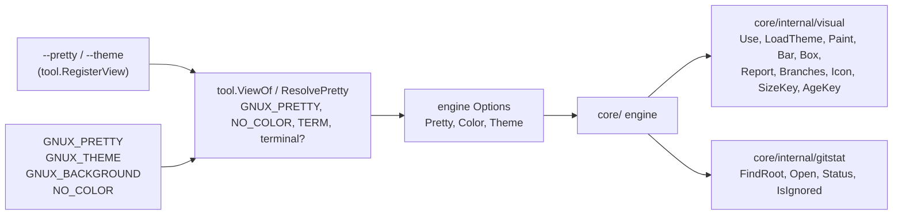

# Terminal visuals

How gnux's terminal view works and how a tool adopts it: the shared layer in `core/internal/visual` (themes in dark and light variants, gradients, bars, boxes, tree branches, icons, report coloring) and `core/internal/gitstat` (git status read straight from the repository), the `--pretty` and `--theme` options and the `GNUX_PRETTY`, `GNUX_THEME`, `GNUX_BACKGROUND`, `GNUX_ICONS` and `NO_COLOR` variables that `internal/tool` resolves the same way for every tool, the rules that keep the view away from anything a program reads (BR-13, NFR-53, NFR-54), and the plan for every tool: which have the view, which will get it and with what, and which never will.

## The pieces



| Package                  | What it gives a tool                                                                 |
|--------------------------|--------------------------------------------------------------------------------------|
| `core/internal/visual`   | `Use(color, name, getenv, warn)` (the theme an engine paints with, nil when uncolored), `LoadTheme(name, getenv)`, `Resolve` and `Dark` (a family's variant for the background), `Theme.Paint(key, s)`, `Theme.Bar(fraction, width, unicode)`, `Theme.Box(title, lines, unicode)`, `Theme.Report(line)`, `Width(s)`, `SizeKey`, `AgeKey`, `BranchesFor(getenv).Prefix(last)`, `Icon(name, kind)`, `UTF8(getenv)`, `ThemeNames()`, `Preview` |
| `core/internal/gitstat`  | `FindRoot(dir)`, `Open(root, getenv)`, `Repo.Status(path, isDir)`, `Repo.IsIgnored(path, isDir)`, `Repo.Close()` |
| `internal/tool`          | `RegisterView(fs)` (the `--pretty[=WHEN]` and `--theme=NAME` options, as names of gnux's own), `ViewOf(fs, terminal, name, getenv, warn)`, `ReportView(fs, s, name, getenv)` (streams whose `Out` colors a `-v` report), `ResolvePretty`, `ParseWhen` |
| `core`                   | `ThemeNames()`, `ReportWriter` and `WriteThemes`, for adapters and `gnux themes` (adapters cannot import `core/internal`) |

A nil `*visual.Theme` paints nothing, so an engine holds `nil` for "no color" and calls `Paint`
and `Bar` the same way either way: the uncolored view (under `NO_COLOR`) is the same code path
with the escapes left out.

## How the view is decided

1. **The option.** `--pretty[=WHEN]`: a bare `--pretty` is `always`, as a bare `--color` is.
2. **Else `GNUX_PRETTY`.** `always`, `auto` or `never` (GNU's `--color` words). An invalid value
   is warned about (`ignoring invalid value of environment variable GNUX_PRETTY: 'x'`) and taken
   as `auto`, as ls treats an invalid `QUOTING_STYLE`.
3. **Else `auto`.** The view is on only when standard output is a terminal.

`tool.ViewOf` returns `View{Pretty, Color, Theme}`. `Color` is `Pretty` minus three cases:
`NO_COLOR` is set, `TERM` is `dumb`, or the output is not a terminal and the view was not asked
for with `always`. `lsx` resolves the same `When` with `tool.ResolvePretty`, because its
`--pretty` is one of its ordered flags and its bundle also sets other options (`--header`, `-h`,
`--group-directories-first`, `--color`), each only when no option already decides it.

The theme, inside the engine (`visual.LoadTheme`), in increasing precedence: the built-in
default (the 16 basic colors, so it follows the terminal's own scheme), the theme named by
`--theme` or else by `GNUX_THEME`, then the `KEY=CODE` pairs after the name in `GNUX_THEME`
(`GNUX_THEME=nord:da=2;34`, or just `GNUX_THEME=ur=36`). An unknown name from the variable is
warned about and skipped; an unknown `--theme` is a usage error.

Most built-in themes are a `scheme` (nine colors from the editor theme they follow, mapped
onto the keys the same way for every theme) in a `FAMILY-dark` and a `FAMILY-light` variant.
A family's own name (`github`) is resolved by `visual.Resolve` to the variant `visual.Dark`
picks: `GNUX_BACKGROUND`, else the background in `COLORFGBG`, else `systemDark` (build-tagged:
`defaults read -g AppleInterfaceStyle` on macOS, asked once per process; the
`AppsUseLightTheme` registry value on Windows; `GTK_THEME` elsewhere), else dark. A new theme
is one line in `schemes`; a new family also goes in `families`, and `TestFamilies` checks that
both variants load and differ. `gnux themes` (`cmd/themes.go`, `visual.Preview`) draws every
theme on a sample row; piped, it prints the names, one a line.

```text
$ GNUX_THEME=mono lsx -l      # bold, underline and dim only
$ lsx -l --theme=dracula | less -R    # no color: a pipe, and not --pretty=always
$ lsx -l --pretty=always --theme=dracula | less -R
```

## The rules

These are what BR-13, NFR-53 and NFR-54 ask for, as a checklist for each adopting tool.

- **Nothing a program reads changes.** Off a terminal the default is GNU's output. An option
  that promises a machine format turns the view off whatever else is set: `lsx --zero`, `dux -0`,
  `dfx -P`. An engine's zero `Options` prints GNU's output: the view is fields of its own
  (`Pretty`, `Color`, `Theme`) that only the adapter sets.
- **Under the colors, the text is GNU's** wherever the view does not add a column. `lsx`'s
  `TestPrettyLong` strips the escapes and compares with the plain listing.
- **The options are gnux's own.** `tool.RegisterView` marks them with `tool.OwnNames`, so no GNU
  abbreviation changes meaning; `lsx`'s own view options are marked the same way.
- **Nothing by color alone.** A status is a letter, a share is a number, a bar has a length.
- **Legible everywhere.** `visual.UTF8(getenv)` picks Unicode or ASCII for branches and bars;
  icons need a Nerd Font, so they are never on by default (`--icons`, `GNUX_ICONS`).
- **One palette.** A tool never invents colors: it names a theme key (`visual.Size`,
  `visual.GitMod`, ...), so every theme and every `GNUX_THEME` override reaches it. A new kind of
  value gets a new key in `style.go`, a default, and a color in each built-in theme's `palette`.
- **Documented.** The tool's `Meta().Long` describes the view and its FR entry gets a "Terminal
  view (BR-13)" paragraph; add the tool to the plan below.

## Adopting the view in a tool

1. **Engine.** Add the fields, leaving the zero value GNU's:

   ```go
   // Pretty is gnux's terminal view, not a GNU option: ...
   Pretty bool
   Color  bool
   Theme  string
   ```

   Load the theme once, only when colored; `visual.Use` returns nil otherwise and warns rather
   than fails on a bad `GNUX_THEME`:

   ```go
   d.theme = visual.Use(d.Pretty && d.Color, d.Theme, d.Getenv, d.diag.Warnf)
   ```

   Then paint at the point of writing: pad first, then `theme.Paint(key, padded)`, so alignment
   is computed on the text. A tool whose output must be measured (`--dired`) writes the escapes
   apart from the text (`lsx`'s `paint` / `putRaw`).
2. **Adapter.** Register and resolve:

   ```go
   tool.RegisterView(fs) // at the end of Register

   view, err := tool.ViewOf(fs, core.IsTerminal(s.Out), du.Name, os.Getenv, s.Err)
   if err != nil {
       return err
   }
   opts.Pretty, opts.Color, opts.Theme = view.Pretty, view.Color, view.Theme
   ```

   Switch `Pretty` off for any option that promises a machine format.

   A tool whose view is only its `-v` report colored needs no engine change at all: the
   adapter wraps the streams with `tool.ReportView`, which colors each line written to `Out`
   (`visual.Theme.Report`: the verb by what it reports, each quoted name, the arrows) and
   leaves them as they were when the view is off or uncolored. A tool that parses its own
   arguments (`chmodx`, `RawArgs`) calls it after parsing.
3. **Tests.** An engine test with `Pretty` and no `Color` (the layout), one with `Color` (a few
   escapes), and one showing that the machine format is untouched. `tool.ViewOf` itself is
   covered once, in `internal/tool/view_test.go`.
4. **Documents.** `Meta().Long`, a scenario example, the FR paragraph, the plan below, and a
   line in `CHANGELOG.md`.

## Inside lsx

`lsx` is the full adopter, and the model for the others (`core/ls/view.go`):

- `prepareView` runs at the end of `prepare`, once color and the format are settled: `--tree`
  forces one entry per line and turns `--dired` off; `--icons` resolves against the terminal;
  the theme loads only when there is a palette and `Pretty` or `ColorScale`.
- `putName` writes `putLead` first (the tree branch in `visual.Branch`, then the icon in the
  name's color), then GNU's alignment pad, then the name; `cellWidth` adds `leadWidth`, so
  columns stay aligned with icons.
- `printLong` builds the same rows as before and writes each column through `paint` with its
  key (`putMode` paints each letter), so `--dired` offsets count only text. `--header` widens
  the columns to their labels; `--git` and `--octal-permissions` are columns of their own.
- `runTree` collects every row of every operand's tree (`treeChildren`, using the same
  `readDir` as `listDir`) and prints them as one listing, so a long tree is one table.
- `repoFor` opens each repository once per run: `gitstat.FindRoot` per directory (cheap), then
  `gitstat.Open` per working tree, and `closeRepos` releases the pack files at the end of `Run`.

## Inside gitstat

`gitstat` reads what `git status` would, without running git (no external program, NFR-18),
through `core/fsys` (so a sandbox confines it):

1. `FindRoot` walks up from a directory to the first `.git` (a directory, or a file naming one:
   linked worktrees and submodules; `commondir` points a worktree at the shared objects).
2. `Open` reads the config (`extensions.objectformat` for SHA-256, `core.fileMode`,
   `core.excludesFile`, `extensions.refStorage`) and the index (versions 2 to 4, prefix-compressed
   names in v4, conflict stages).
3. `Status` compares on demand and memoizes: the index with HEAD's tree for the staged letter
   (HEAD resolved through loose refs and `packed-refs`, trees read from loose objects or pack
   files with offset and reference deltas), and the file with the index for the unstaged one
   (stat data first, as git trusts it, then the content's object name). A directory takes the
   most significant letter of what is under it, including untracked files found by walking it
   past ignored directories and nested repositories.
4. `IsIgnored` applies the global excludes file, `.git/info/exclude` and each `.gitignore` from
   the top down, last match winning, `**` and anchoring as gitignore(5) describes, and nothing
   re-included under an excluded directory.

Not done, and documented in FR-60: rename detection, line-ending conversion, reftable
references and alternates.

## The plan for every tool

Every tool was looked at. A tool gets the view when its output is for a person to read and has
structure the layer can show (a table, sizes, a hierarchy, a status); a tool whose output is
data for the next command in a pipeline gets none, because there is nothing to show that would
not change the data.

### Have the view

| Tool                  | The view                                                                 |
|-----------------------|--------------------------------------------------------------------------|
| `lsx`, `dirx`, `vdirx` | Field colors, header, readable sizes, directories first; `--tree`, `--level`, `--icons`, `--git`, `--git-ignore`, `--color-scale`, `--only-dirs`, `--only-files`, `--total-size`, `--octal-permissions` |
| `dfx`                 | A usage bar after each percentage (green, yellow from 75%, red from 90%), themed header and mount points |
| `dux`                 | Aligned sizes on the size gradient, a bar and percentage of each line's share, names highlighted |
| `grepx`               | Each file's name once, as a heading over its lines (key `fh`), a blank line between files, line numbers on; GNU's `--color` colors the rest |
| `md5sumx`, `sha1sumx`, `sha224sumx`, `sha256sumx`, `sha384sumx`, `sha512sumx`, `b2sumx`, `cksumx` | With `-c`: `OK` (key `ok`) and `FAILED` (key `er`) colored, and a count for each list (`2 OK, 1 FAILED`) |
| `headx`, `tailx`      | The `==> file <==` headers in the heading color                          |
| `cpx`, `mvx`, `rmx`, `lnx`, `installx`, `mkdirx`, `rmdirx`, `chmodx`, `chownx`, `chgrpx` | With `-v`: the verb (a removal red, a creation green), each quoted name (key `pa`) and the arrows colored, through `tool.ReportView` |
| `gnux themes`         | Every theme on a sample row, in a box naming the theme in use and the background |

### Planned, in this order

| Tool                                   | The view to add                                                     |
|----------------------------------------|---------------------------------------------------------------------|
| `findx`                                | `--tree` for the matches, names colored and iconed as `lsx` does     |
| `ddx`, `shredx`                        | A progress bar for `status=progress` and `-v`                       |
| `statx`                                | Field names dimmed, the mode painted as `lsx` paints it, in a box (`Theme.Box`) |
| `wcx`                                  | Aligned, colored counts with a header, the total emphasized          |
| `uniqx -c`, `sortx`                    | `uniqx -c`'s counts on a gradient with a bar                         |
| `odx`                                  | Bytes colored by class (zero, printable, whitespace, other)          |
| `uptimex`, `nprocx`                    | Load averages as bars against the CPU count                         |
| `whox`, `usersx`, `pinkyx`, `idx`, `groupsx` | A header and the caller's own entries emphasized               |
| `envx`, `printenvx`                    | Names colored apart from values (no arguments only)                  |
| `killx -l`, `sttyx -a`                 | Tables with headers                                                 |
| `commx`, `joinx`                       | Each column colored by origin                                       |
| `datex`, `unamex`                      | Field names with `--pretty` only (`auto` would change data a script may capture from a terminal) |
| `gnux shell`                           | A colored prompt and `help`, and the view passed to the tools it runs |

### No view, by design

The output of these is data, so the view would change what the next command reads, or there
is nothing to show: `archx`, `base32x`, `base64x`, `basencx`, `basenamex`, `catx`, `csplitx`,
`cutx`, `dircolorsx`, `dirnamex`, `echox`, `expandx`, `exprx`, `factorx`, `falsex`, `fmtx`,
`foldx`, `hostidx`, `hostnamex`, `linkx`, `lognamex`, `mkfifox`, `mknodx`, `mktempx`, `nicex`,
`nlx`, `nohupx`, `numfmtx`, `pastex`, `pathchkx`, `printfx`, `prx`, `ptxx`, `pwdx`, `readlinkx`,
`realpathx`, `sedx`, `seqx`, `shufx`, `sleepx`, `splitx`, `sumx`, `stdbufx`, `syncx`, `tacx`, `teex`,
`testx`, `timeoutx`, `touchx`, `trx`, `truex`, `truncatex`, `tsortx`, `ttyx`, `unexpandx`,
`unlinkx`, `whoamix`, `xargsx`, `yesx`.

## Tests

| Test                                                | Pins                                                         |
|-----------------------------------------------------|--------------------------------------------------------------|
| `core/internal/visual/visual_test.go`               | Theme overlays and precedence, families and `Dark`, gradients, branches (Unicode and ASCII), bars, icons (NFR-54) |
| `core/internal/visual/box_test.go`, `report_test.go` | Boxes and `Width`, `Preview`, the `-v` report coloring (a name holding a quote stays whole) |
| `core/internal/gitstat/gitstat_test.go`             | Status and ignore rules against real git: loose objects, packs with deltas, SHA-256, deletions, an unborn branch |
| `internal/tool/view_test.go` (`TestViewOf`)         | `--pretty`, `GNUX_PRETTY`, `NO_COLOR`, `TERM=dumb`, `--theme` (NFR-53, NFR-54) |
| `core/ls/view_test.go`                              | Trees, `--level`, filters, icons in columns, header, octal, total size, themed long format, git (FR-60) |
| `cmd/lsx/view_test.go`                              | The flags, and the pretty bundle's defaults and their precedence (NFR-53) |
| `core/df/df_test.go`, `core/du/du_test.go` (`TestPretty`) | The bars and layout, and the machine formats untouched (FR-107, FR-108) |
| `core/grep/view_test.go`, `cmd/grepx/view_test.go`  | Headings, context separators within a file only, `-c` and `-Z` untouched, the adapter's defaults |
| `core/hashsum/hashsum_test.go` (`TestCheckPretty`)  | The count line, the colors, and `--status` still silent        |
| `core/head/head_test.go`, `core/tail/tail_test.go` (`TestColoredHeaders`) | The headers' color, the text unchanged              |

## Related documents

- [engine-run](engine-run.md): the engine contract the view's fields follow.
- [adding-a-tool](adding-a-tool.md): where the view's steps fit when a tool is new.
- [functional-requirements](../requirements/functional-requirements.md): FR-60, FR-107, FR-108.
- [business-requirements](../requirements/business-requirements.md): BR-13.
